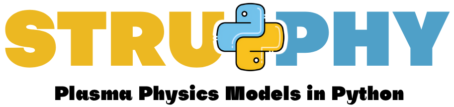

Welcome to
==========

|

This website is your starting point for solving PDEs with Struphy!
Check the topics below for detailed information on a subject.

`<https://github.com/struphy-hub/struphy>`_ is the launch point for the related source code.

The Struphy website `<https://struphy-hub.github.io/>`_ gives an overview of the models, the numerical methods
and a gallery of examples. Ready-to-run simulations are in `struphy-examples <https://github.com/struphy-hub/struphy-examples>`_,
see :ref:`quickstart_examples`.

The code is freely available under an `MIT license <https://github.com/struphy-hub/struphy/blob/devel/LICENSE>`_ - Copyright (c) 2019-2026, Struphy developers, Max Planck Institute for Plasma Physics.

.. toctree::
   :maxdepth: 1
   :caption: Contents:

   sections/abstract
   sections/install
   sections/quickstart
   sections/userguide
   sections/api_guide
   sections/models
   sections/propagators
   sections/tutorials
   sections/numerics
   sections/domains
   sections/fluid-equils
   sections/kinetic-equils
   sections/perturbations
   sections/dev_guide
   sections/dev_reference

   

