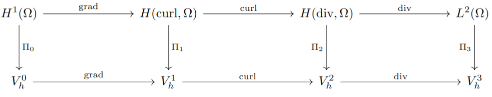
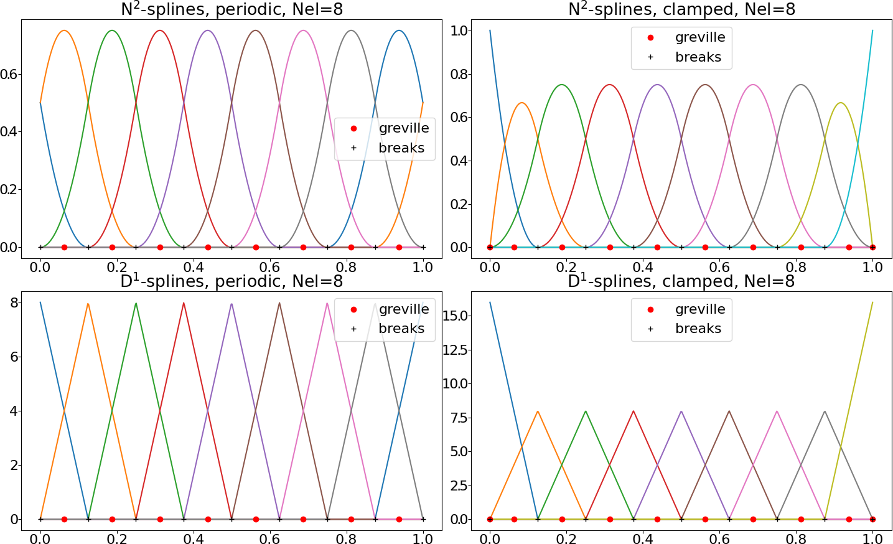
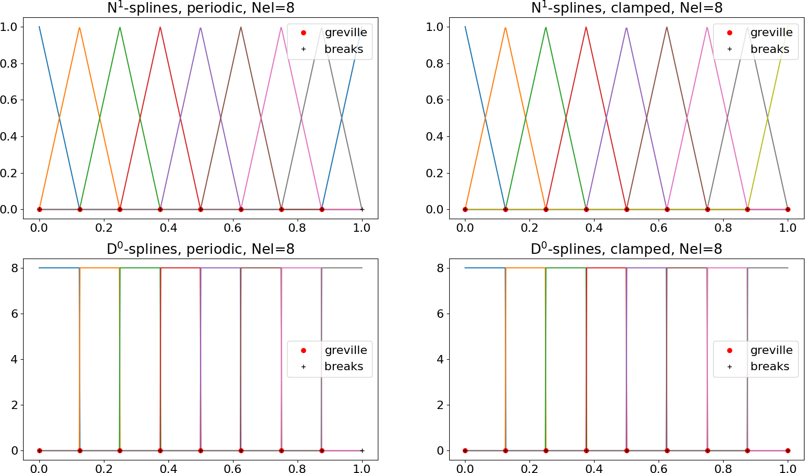
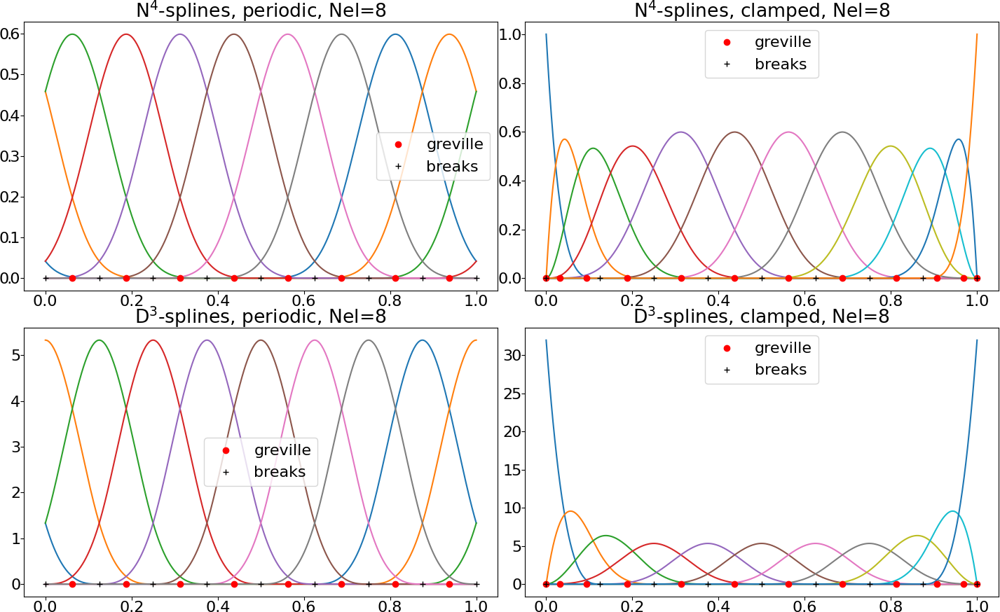
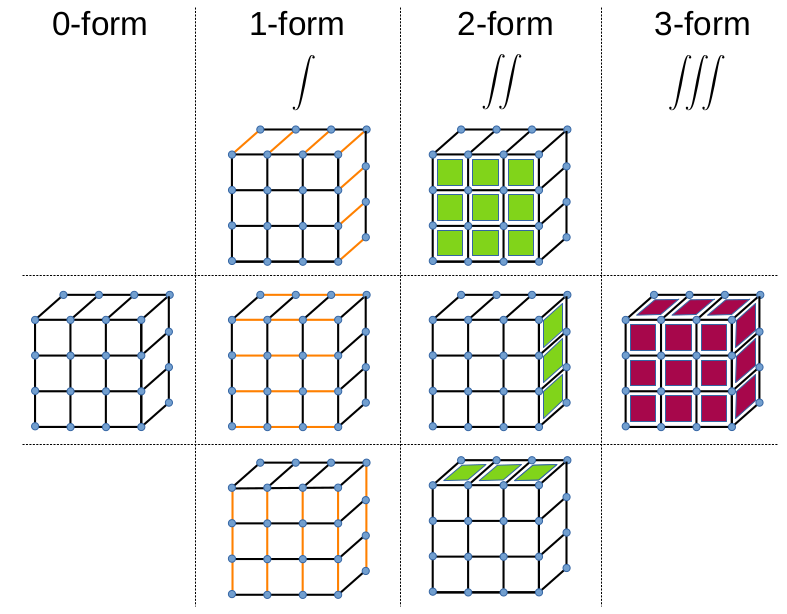
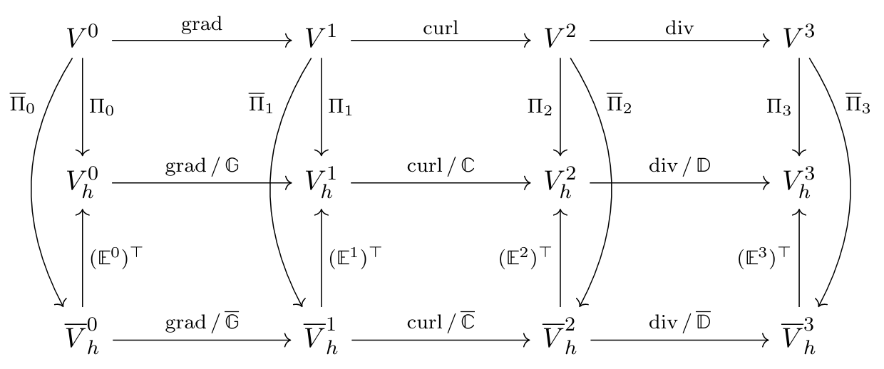

.. _geomFE:

Geometric finite elements (FEEC)
--------------------------------

This page introduces the finite element method used in Struphy for electromagnetic fields and fluid variables.
It is based on *finite element exterior calculus* (FEEC), which grew out of the edge elements of
:footcite:t:`Nedelec1980` and the Whitney forms of :footcite:t:`Bossavit1988`, was developed for electromagnetism by
:footcite:t:`Hiptmair2002` and given its general form by :footcite:t:`Arnold2006,Arnold2010`
(see also the monograph :footcite:t:`Arnold2018`). Struphy uses the spline version of FEEC, the isogeometric
discrete differential forms of :footcite:t:`Buffa2010,Buffa2011`, on a mapped unit cube, together with the
C1 polar splines of :footcite:t:`Holderied2022` for domains with a magnetic axis. The combination with
particle-in-cell methods follows the GEMPIC framework :footcite:p:`Kraus2017`; its use in MHD-kinetic hybrid
models is described in :footcite:t:`Holderied2021,Possanner2023`. A list of all references is at the
:ref:`end of the page <feec_references>`.

.. _feec_overview:

Overview
^^^^^^^^

In a **conforming finite element (FE) method**, a function :math:`u \in V` in a function space :math:`V` is
approximated as

.. math::

    u \approx u_h = \sum_{i=1}^{M} u_i \Lambda_i \quad \in V_h\,,

where :math:`\Lambda_i \in V` are linearly independent basis functions, :math:`(u_i)_i \in \mathbb R^M` are the
**FE coefficients** and :math:`M` is the dimension of the subspace :math:`V_h \subset V` spanned by the basis functions.
Unlike in spectral methods, each :math:`\Lambda_i` has a local support around some grid point. Since
:math:`u_h \in V`, the discrete function has the same regularity as the continuous one, which leads to an elegant
analysis of the method. Implementing a FE method means writing a system of equations for the coefficients
:math:`(u_i)_i`, while the basis functions are fixed.

Maxwell's equations, the MHD equations and many other field equations of plasma physics contain the operators grad,
curl and div, and their solutions satisfy constraints such as :math:`\nabla \cdot \mathbf B = 0` or Gauss' law.
A FE method in which each variable is approximated in a space adapted to its operator (and not, for instance,
every vector component in the same scalar space) keeps the structure of these equations on the discrete level.
In Struphy, the FEEC spaces guarantee that

* the discrete derivatives satisfy :math:`\textnormal{curl}\,\textnormal{grad} = 0` and
  :math:`\textnormal{div}\,\textnormal{curl} = 0` exactly, so that e.g. :math:`\nabla \cdot \mathbf B_h = 0`
  holds pointwise for all times if it holds initially;
* the discrete derivatives of tensor-product splines are matrices with entries :math:`0` and :math:`\pm 1` that do not
  depend on the mapping of the domain: the geometry enters only through mass matrices (with
  :ref:`polar splines <polar_splines>`, the extraction operators at the pole also depend on the mapping);
* projections of continuous functions into the discrete spaces commute with the derivatives;
* the discrete curl-curl and grad-div operators have no spurious eigenmodes (spectral correctness)
  :footcite:p:`Hiptmair2002,Boffi2013`;
* the semi-discrete equations inherit the energy conservation and the Hamiltonian (or variational) structure of the
  continuous models, which can then be preserved in time with suitable integrators :footcite:p:`Kraus2017`.

The basis functions in Struphy are tensor-product B-splines :footcite:p:`Hughes2005` on the unit cube
:math:`[0, 1]^3`, the *logical domain*. The physical domain is the image of the unit cube under a mapping, see
:ref:`avail_mappings`, and the equations are written on the logical domain with the transformation rules of
differential forms (:ref:`feec_forms`). The splines and the parallel linear algebra are provided by the library
`feectools <https://github.com/struphy-hub/feectools>`_, a fork of Psydac :footcite:p:`Guclu2022` maintained for
Struphy; the entry point in Struphy is the class :class:`~struphy.feec.psydac_derham.Derham`.

The sections of this page are:

* :ref:`feec_derham`: the continuous spaces and the de Rham diagram,
* :ref:`feec_forms`: pullbacks of scalar and vector fields to the unit cube,
* :ref:`uni_variate_spaces` and :ref:`feec_tensor_spaces`: the discrete spaces,
* :ref:`feec_derivatives` and :ref:`feec_projectors`: derivatives and projections,
* :ref:`feec_mass`: mass matrices, weak derivatives and the example of Maxwell's equations,
* :ref:`feec_bcs`, :ref:`polar_splines` and :ref:`feec_solvers`.

.. _feec_derham:

The de Rham complex
^^^^^^^^^^^^^^^^^^^

The FEEC spaces in 3D are a sequence of discrete (finite-dimensional) spaces :math:`V_h^n,\,0\leq n \leq 3`, that
satisfy the **3D de Rham diagram**:

    Fig. 1: 3D de Rham diagram.

The upper row is a sequence of continuous function spaces on a domain :math:`\Omega`:

* :math:`H^1(\Omega)`: functions :math:`f \in L^2(\Omega)` with :math:`\nabla f \in (L^2(\Omega))^3`,
* :math:`H(\textnormal{curl}, \Omega)`: functions :math:`\mathbf u \in (L^2(\Omega))^3` with
  :math:`\nabla \times \mathbf u \in (L^2(\Omega))^3`,
* :math:`H(\textnormal{div}, \Omega)`: functions :math:`\mathbf u \in (L^2(\Omega))^3` with
  :math:`\nabla \cdot \mathbf u \in L^2(\Omega)`,
* :math:`L^2(\Omega)`: square-integrable functions.

These spaces are discussed in many textbooks on mixed finite elements, for instance
:footcite:t:`Brezzi1991,Boffi2013` and, for Maxwell's equations, :footcite:t:`Monk2003`.
Struphy uses a conforming method,

.. math::

    V_h^0 \subset H^1(\Omega),\qquad V_h^1 \subset H(\textnormal{curl}, \Omega),\qquad V_h^2 \subset H(\textnormal{div}, \Omega),\qquad V_h^3 \subset L^2(\Omega)\,.

Both the continuous and the discrete spaces form a **complex**: the image of each operator lies in the kernel of the
next one,

.. math::

    \textnormal{curl}\,\textnormal{grad}  = 0\,,\qquad \textnormal{div}\,\textnormal{curl} = 0\,,

on both levels. The vertical arrows are projectors :math:`\Pi_n,\,0\leq n \leq 3` (:math:`\Pi_n^2 = \Pi_n`) into the
discrete spaces,

.. math::

    \Pi_0: \, H^1(\Omega) \to V_h^0,\qquad \Pi_1:\, H(\textnormal{curl}, \Omega) \to V_h^1,\qquad \Pi_2:\, H(\textnormal{div}, \Omega) \to V_h^2,\qquad \Pi_3:\, L^2(\Omega) \to V_h^3\,,

and the diagram **commutes**:

.. math::
    :label: commute

    \Pi_1\textnormal{grad} = \textnormal{grad}\,\Pi_0\,,\qquad \Pi_2\textnormal{curl} = \textnormal{curl}\,\Pi_1\,,\qquad \Pi_3\textnormal{div} = \textnormal{div}\,\Pi_2\,.

The commuting projectors are the key tool in the analysis of FEEC :footcite:p:`Arnold2006,Arnold2010`: together with
the complex property, they imply that the discrete spaces inherit the kernels of the derivatives (for example,
discrete curl-free fields are discrete gradients on simply connected domains), and from this the stability and
spectral correctness of the method.

In the language of differential geometry, the four spaces contain the coefficient functions ("proxies") of
:math:`0`-, :math:`1`-, :math:`2`- and :math:`3`-forms, and grad, curl and div are the exterior derivative
:math:`\textnormal d` acting on these forms. We therefore call elements of :math:`V_h^n` also discrete
:math:`n`-forms. This viewpoint explains how the spaces transform under a change of coordinates, discussed next.

.. _feec_forms:

Differential forms on mapped domains
^^^^^^^^^^^^^^^^^^^^^^^^^^^^^^^^^^^^

All equations in Struphy are discretized on the logical unit cube :math:`\hat \Omega = (0, 1)^3` with coordinates
:math:`\boldsymbol \eta = (\eta_1, \eta_2, \eta_3)`. The physical domain :math:`\Omega` with Cartesian coordinates
:math:`\mathbf x` is the image of a mapping :math:`F: \hat\Omega \to \Omega,\, \boldsymbol \eta \mapsto \mathbf x`,
with Jacobian matrix :math:`DF`, metric tensor :math:`G = DF^\top DF` and Jacobian determinant
:math:`\sqrt g = \det DF > 0` (only right-handed mappings are allowed). The available mappings are listed in
:ref:`avail_mappings`.

A scalar or vector field on :math:`\Omega` has several representations on :math:`\hat \Omega`, which differ in how they
transform. Given a scalar function :math:`p(\mathbf x)` and a vector field :math:`\mathbf E(\mathbf x)`, the
**pullbacks** are

.. math::
    :nowrap:

    \begin{align}
    \textnormal{0-form:}&\quad \hat p^0(\boldsymbol \eta) = p(F(\boldsymbol \eta))\,,
    &\textnormal{3-form:}&\quad \hat p^3(\boldsymbol \eta) = \sqrt g(\boldsymbol \eta)\, p(F(\boldsymbol \eta))\,,
    \\[2mm]
    \textnormal{1-form:}&\quad \hat{\mathbf E}^1(\boldsymbol \eta) = DF^\top(\boldsymbol \eta)\, \mathbf E(F(\boldsymbol \eta))\,,
    &\textnormal{2-form:}&\quad \hat{\mathbf E}^2(\boldsymbol \eta) = \sqrt g(\boldsymbol \eta)\, DF^{-1}(\boldsymbol \eta)\, \mathbf E(F(\boldsymbol \eta))\,,
    \\[2mm]
    \textnormal{vector field:}&\quad \hat{\mathbf E}(\boldsymbol \eta) = DF^{-1}(\boldsymbol \eta)\, \mathbf E(F(\boldsymbol \eta))\,.
    \end{align}

The components of the 1-form are the co-variant components of :math:`\mathbf E`, those of the vector field the
contra-variant components; the 2-form and the 3-form are densities (they carry the volume element :math:`\sqrt g`).
The physical meaning of a variable decides its representation: :math:`\hat p^0` for a quantity that is evaluated at
points (a potential), :math:`\hat{\mathbf E}^1` for a quantity integrated along curves (an electric field),
:math:`\hat{\mathbf B}^2` for a flux through surfaces (a magnetic field) and :math:`\hat n^3` for a quantity integrated
over volumes (a density). Vector fields, e.g. a fluid velocity :math:`\hat{\mathbf u}`, are approximated in the space
:math:`(V_h^0)^3` (``"H1vec"`` in Struphy).

The derivatives commute with the pullbacks:

.. math::
    :nowrap:

    \begin{align}
    \nabla p = DF^{-\top}\, \hat\nabla \hat p^0\,,\qquad
    \nabla \times \mathbf E = \frac{DF}{\sqrt g}\, \hat\nabla \times \hat{\mathbf E}^1\,,\qquad
    \nabla \cdot \mathbf E = \frac{1}{\sqrt g}\, \hat\nabla \cdot \hat{\mathbf E}^2\,,
    \end{align}

where :math:`\hat \nabla = (\partial_{\eta_1}, \partial_{\eta_2}, \partial_{\eta_3})`. In words: the gradient of a
0-form is a 1-form, the curl of a 1-form is a 2-form and the divergence of a 2-form is a 3-form, and in each case the
logical derivative is the plain derivative in :math:`\boldsymbol \eta`, **independent of the mapping**. The metric
appears only in the :math:`L^2` inner products, for instance

.. math::
    :nowrap:

    \begin{align}
    \int_\Omega \mathbf E \cdot \mathbf F \,\textnormal d \mathbf x &= \int_{\hat \Omega} \hat{\mathbf E}^1 \cdot G^{-1} \hat{\mathbf F}^1 \sqrt g \,\textnormal d \boldsymbol \eta\,,
    &\int_\Omega \mathbf B \cdot \mathbf C \,\textnormal d \mathbf x &= \int_{\hat \Omega} \hat{\mathbf B}^2 \cdot G\, \hat{\mathbf C}^2 \frac{1}{\sqrt g} \,\textnormal d \boldsymbol \eta\,,
    \\[2mm]
    \int_\Omega p\, q \,\textnormal d \mathbf x &= \int_{\hat \Omega} \hat p^0 \hat q^0 \sqrt g \,\textnormal d \boldsymbol \eta\,,
    &\int_\Omega n\, m \,\textnormal d \mathbf x &= \int_{\hat \Omega} \hat n^3 \hat m^3 \frac{1}{\sqrt g} \,\textnormal d \boldsymbol \eta\,,
    \end{align}

which define the mass matrices in :ref:`feec_mass`. The pullback of a whole model is worked out in
:ref:`pullback` of the Vlasov-Maxwell example. In what follows we drop the hats; all spaces live on the unit cube.

.. _uni_variate_spaces:

Uni-variate spline spaces
^^^^^^^^^^^^^^^^^^^^^^^^^

Finite element spaces in Struphy are built from uni-variate B-spline spaces on the interval :math:`\eta \in [0, 1]`,
as introduced for instance in Section 2.2 of :footcite:t:`Hughes2005`.
B-spline basis functions of degree :math:`p` are denoted by :math:`N_i^p(\eta)` (called **N-splines** in the following).
They are **piecewise polynomials** with a regularity of at most :math:`p-1` (they are piecewise constants for :math:`p=0`).
Linear combinations of these basis functions give a **spline function**

.. math::

    f_h(\eta) = \sum_{i=0}^{n-1} f_i N^p_i(\eta)\,,\qquad f_i \in \mathbb R\,,

where :math:`\mathbf f = (f_i)_{i=0}^{n-1} \in \mathbb R^n` are the **spline coefficients** and :math:`n` is the
dimension of the spline space. Struphy supports two kinds of splines in each direction: **periodic** or **clamped**.
For clamped splines, the first and last basis functions are interpolatory at :math:`\eta=0` and :math:`\eta=1`,
respectively, meaning that :math:`f_h(0) = f_0` and :math:`f_h(1) = f_{n-1}`.
If the interval :math:`[0, 1]` is split into :math:`n_\textnormal{el}` cells (elements),
the dimension of the periodic space is :math:`n = n_\textnormal{el}`, and that of the clamped space is
:math:`n = n_\textnormal{el} + p`. Fig. 2 shows the spline basis functions of degree :math:`p=2` on
:math:`n_\textnormal{el}=8` cells.

    Fig. 2: Uni-variate spline spaces of degree :math:`p=2`.

In Fig. 2 the black crosses are the **break points** (cell interfaces) and the red dots are the **Greville points**,
which are the interpolation points of the commuting projectors (see :ref:`feec_projectors`).
The second row shows the **D-splines**, which are related to the derivatives of N-splines via

.. math::
    :label: dspline

    \frac{\textnormal d }{\textnormal d \eta} N_i^p = D^{p-1}_{i-1} - D^{p-1}_i\,.

D-splines are B-splines of degree :math:`p-1` rescaled to unit integral,
:math:`\int_0^1 D^{p-1}_i \,\textnormal d \eta = 1`, which makes them the natural basis for histopolation. In the clamped case the dimension :math:`d` of the D-spline space is one less
than that of the N-splines, :math:`d = n - 1`, and :math:`D^{p-1}_{-1} = D^{p-1}_{n-1} = 0`; in the periodic case
:math:`d = n`. The pair (N-splines, D-splines) is the uni-variate de Rham complex: the derivative maps the space of
N-splines onto the space of D-splines in the clamped case, and onto the D-spline functions with zero mean in the
periodic case.

Fig. 3 shows the uni-variate spline spaces for degree :math:`p=1`.
Here the D-splines are piecewise constants and a D-spline function is in general not continuous.

    Fig. 3: Uni-variate spline spaces of degree :math:`p=1`.

N-splines in Struphy have the maximal regularity :math:`C^{p-1}`, and the support of each basis function spans
:math:`p+1` adjacent cells. A higher degree gives smoother and more accurate approximations (the error in
:math:`L^2` decreases like :math:`h^{p+1}` for N-splines and :math:`h^p` for D-splines, with the cell size :math:`h`),
at the price of more non-zero entries in the matrices. Fig. 4 shows an example with :math:`p=4`.

    Fig. 4: Uni-variate spline spaces of degree :math:`p=4`.

.. _feec_tensor_spaces:

Tensor-product spline spaces
^^^^^^^^^^^^^^^^^^^^^^^^^^^^

The discrete spaces :math:`V_h^n,\,0\leq n \leq 3` are spanned by tensor products of the uni-variate N- and
D-splines of degrees :math:`(p_1, p_2, p_3)`, with dimensions :math:`n_\mu` (N-splines) and :math:`d_\mu` (D-splines)
in direction :math:`\mu`. A D-spline is used in every direction in which the form is "integrated", following the
pattern of Fig. 1:

.. math::
    :nowrap:

    \begin{align}
    \Lambda^0_{ijk}(\eta_1,\eta_2,\eta_3) &= N_i^{p_1}(\eta_1) N_j^{p_2}(\eta_2) N_k^{p_3}(\eta_3)\,,\qquad &&\mathbf \Lambda^0 = (\Lambda^0_{ijk})_{i=0, j=0, k=0}^{n_1-1, n_2-1, n_3-1} \qquad \\\\

    \vec{\Lambda}^1_{1,ijk}(\eta_1,\eta_2,\eta_3) &= \begin{pmatrix} D_i^{p_1 - 1}(\eta_1) N_j^{p_2}(\eta_2) N_k^{p_3}(\eta_3) \\ 0 \\ 0 \end{pmatrix}\,,\qquad &&\vec{\mathbf \Lambda}^1_1 = (\vec \Lambda^1_{1,ijk})_{i=0, j=0, k=0}^{d_1-1, n_2-1, n_3-1} \\\\

    \vec{\Lambda}^1_{2,ijk}(\eta_1,\eta_2,\eta_3) &= \begin{pmatrix} 0 \\ N_i^{p_1}(\eta_1) D_j^{p_2 - 1}(\eta_2) N_k^{p_3}(\eta_3) \\ 0 \end{pmatrix}\,,\qquad &&\vec{\mathbf \Lambda}^1_2 = (\vec \Lambda^1_{2,ijk})_{i=0, j=0, k=0}^{n_1-1, d_2-1, n_3-1} \\\\

    \vec{\Lambda}^1_{3,ijk}(\eta_1,\eta_2,\eta_3) &= \begin{pmatrix} 0 \\ 0 \\ N_i^{p_1}(\eta_1) N_j^{p_2}(\eta_2) D_k^{p_3 - 1}(\eta_3) \end{pmatrix}\,,\qquad &&\vec{\mathbf \Lambda}^1_3 = (\vec \Lambda^1_{3,ijk})_{i=0, j=0, k=0}^{n_1-1, n_2-1, d_3-1} \\\\

    \vec{\Lambda}^2_{1,ijk}(\eta_1,\eta_2,\eta_3) &= \begin{pmatrix} N_i^{p_1}(\eta_1) D_j^{p_2 - 1}(\eta_2) D_k^{p_3 - 1}(\eta_3) \\ 0 \\ 0 \end{pmatrix}\,,\qquad &&\vec{\mathbf \Lambda}^2_1 = (\vec \Lambda^2_{1,ijk})_{i=0, j=0, k=0}^{n_1-1, d_2-1, d_3-1} \\\\

    \vec{\Lambda}^2_{2,ijk}(\eta_1,\eta_2,\eta_3) &= \begin{pmatrix} 0 \\ D_i^{p_1 - 1}(\eta_1) N_j^{p_2}(\eta_2) D_k^{p_3 - 1}(\eta_3) \\ 0 \end{pmatrix}\,,\qquad &&\vec{\mathbf \Lambda}^2_2 = (\vec \Lambda^2_{2,ijk})_{i=0, j=0, k=0}^{d_1-1, n_2-1, d_3-1} \\\\

    \vec{\Lambda}^2_{3,ijk}(\eta_1,\eta_2,\eta_3) &= \begin{pmatrix} 0 \\ 0 \\ D_i^{p_1 - 1}(\eta_1) D_j^{p_2 - 1}(\eta_2) N_k^{p_3}(\eta_3) \end{pmatrix}\,,\qquad &&\vec{\mathbf \Lambda}^2_3 = (\vec \Lambda^2_{3,ijk})_{i=0, j=0, k=0}^{d_1-1, d_2-1, n_3-1} \\\\

    \Lambda^3_{ijk}(\eta_1,\eta_2,\eta_3) &= D_i^{p_1 - 1}(\eta_1) D_j^{p_2 - 1}(\eta_2) D_k^{p_3 - 1}(\eta_3)\,,\qquad &&\mathbf \Lambda^3 = (\Lambda^3_{ijk})_{i=0, j=0, k=0}^{d_1-1, d_2-1, d_3-1} \qquad
    \end{align}

Elements of the discrete spaces are linear combinations of the respective basis functions:

.. math::
    :nowrap:

    \begin{align}
    V_h^0 &= \textnormal{span}(\mathbf \Lambda^0)\,,\qquad p_h(\eta_1,\eta_2,\eta_3) = \sum_{ijk} p_{ijk}\, \Lambda^0_{ijk}(\eta_1,\eta_2,\eta_3) = \mathbf p^\top \mathbf \Lambda^0  \quad \in \,V_h^0 \\

    V_h^1 &= \textnormal{span}(\vec{\mathbf \Lambda}^1_1, \vec{\mathbf \Lambda}^1_2, \vec{\mathbf \Lambda}^1_3)\,, \\

    &\qquad\qquad \mathbf E_h(\eta_1,\eta_2,\eta_3) = \sum_{\mu=1}^3 \sum_{ijk} e_{\mu, ijk}\,\vec{\Lambda}^1_{\mu, ijk}(\eta_1,\eta_2,\eta_3) = \sum_{\mu=1}^3 \mathbf e_\mu^\top \vec{\mathbf \Lambda}^1_\mu = \mathbf e^\top \vec{\mathbf \Lambda}^1 \quad \in \,V_h^1 \\

    V_h^2 &= \textnormal{span}(\vec{\mathbf \Lambda}^2_1, \vec{\mathbf \Lambda}^2_2, \vec{\mathbf \Lambda}^2_3)\,, \\
    &\qquad \qquad \mathbf B_h(\eta_1,\eta_2,\eta_3) = \sum_{\mu=1}^3 \sum_{ijk} b_{\mu, ijk}\,\vec{\Lambda}^2_{\mu, ijk}(\eta_1,\eta_2,\eta_3) = \sum_{\mu=1}^3 \mathbf b_\mu^\top \vec{\mathbf \Lambda}^2_\mu = \mathbf b^\top \vec{\mathbf \Lambda}^2 \quad \in \,V_h^2 \\

    V_h^3 &= \textnormal{span}(\mathbf \Lambda^3)\,,\qquad n_h(\eta_1,\eta_2,\eta_3) = \sum_{ijk}^{\phantom{3}} n_{ijk}\, \Lambda^3_{ijk}(\eta_1,\eta_2,\eta_3) = \mathbf n^\top \mathbf \Lambda^3  \quad \in \,V_h^3
    \end{align}

A discrete field is thus represented by its **FE coefficients** :math:`\mathbf p \in \mathbb R^{N_0}`,
:math:`\mathbf e \in \mathbb R^{N_1}`, :math:`\mathbf b \in \mathbb R^{N_2}` and :math:`\mathbf n \in \mathbb R^{N_3}`,
where the space dimensions are products of the uni-variate dimensions:

.. math::
    :nowrap:

    \begin{align}
    \textnormal{dim} V_h^0 &= N_0 = n_1 n_2 n_3\,, \\\\

    \textnormal{dim} V_h^1 &= N_1 = d_1 n_2 n_3 + n_1 d_2 n_3 + n_1 n_2 d_3\,, \\\\

    \textnormal{dim} V_h^2 &= N_2 = n_1 d_2 d_3 + d_1 n_2 d_3 + d_1 d_2 n_3\,, \\\\

    \textnormal{dim} V_h^3 &= N_3 = d_1 d_2 d_3\,.
    \end{align}

In Struphy, the spaces, derivatives and projectors are held by the class :class:`~struphy.feec.psydac_derham.Derham`,
which is created from the grid and the :class:`~struphy.DerhamOptions` (degrees, boundary conditions,
quadrature, polar splines) of the parameter file. A discrete field is a
:class:`~struphy.feec.psydac_derham.SplineFunction`, created with
:meth:`Derham.create_spline_function() <struphy.feec.psydac_derham.Derham.create_spline_function>`. It has

1. the property ``vector`` holding the FE coefficients, with a setter,
2. a ``__call__()`` method for evaluating the spline at (an array of) points :math:`(\eta_{ijk})_{ijk}`.

The coefficient vectors are distributed over the MPI ranks by a domain decomposition of the index space: each rank owns
a block of coefficients in each direction plus ghost regions of width :math:`p_\mu` for the overlap with its neighbors
(``StencilVector`` of feectools; a ``BlockVector`` of three of them for 1- and 2-forms). Matrices are stored
in the corresponding ``StencilMatrix`` format, with band width given by the degrees.

.. _feec_derivatives:

Discrete derivatives
^^^^^^^^^^^^^^^^^^^^

Because of :math:numref:`dspline`, the derivatives of discrete fields are again discrete fields in the next space,
and they act on the FE coefficients only:

.. math::
    :nowrap:

    \begin{align}
    \textnormal{grad}\, p_h &= (\mathbb G \mathbf p)^\top \vec{\mathbf \Lambda}^1 \quad \in \,V_h^1\,, \\\\

    \textnormal{curl}\, \mathbf E_h &= (\mathbb C \mathbf e)^\top \vec{\mathbf \Lambda}^2 \quad \in \,V_h^2\,, \\\\

    \textnormal{div}\, \mathbf B_h &= (\mathbb D \mathbf b)^\top \mathbf \Lambda^3 \quad \in \,V_h^3\,.
    \end{align}

The discrete gradient :math:`\mathbb G \in \mathbb R^{N_1 \times N_0}`, curl
:math:`\mathbb C \in \mathbb R^{N_2 \times N_1}` and divergence :math:`\mathbb D \in \mathbb R^{N_3 \times N_2}`
are built from Kronecker products of the uni-variate difference matrix
:math:`(\mathbb d \mathbf f)_i = f_{i+1} - f_i` (from :math:numref:`dspline`) and identity matrices, for example

.. math::

    \mathbb G = \begin{pmatrix} \mathbb d \otimes \mathbb I \otimes \mathbb I \\ \mathbb I \otimes \mathbb d \otimes \mathbb I \\ \mathbb I \otimes \mathbb I \otimes \mathbb d \end{pmatrix}\,,\qquad
    \mathbb D = \begin{pmatrix} \mathbb d \otimes \mathbb I \otimes \mathbb I & \mathbb I \otimes \mathbb d \otimes \mathbb I & \mathbb I \otimes \mathbb I \otimes \mathbb d \end{pmatrix}\,.

Their entries are :math:`0` and :math:`\pm 1`: they are the incidence matrices of the grid (which point bounds which
edge, which edge bounds which face, ...), as in the discrete exterior calculus. They do not depend on the mapping
:math:`F` (except for the extraction operators of :ref:`polar_splines`) and they satisfy the complex property exactly, also in floating-point arithmetic:

.. math::

    \mathbb C\, \mathbb G = 0\,,\qquad \mathbb D\, \mathbb C = 0\,.

The derivative matrices are available as ``Derham.grad``, ``Derham.curl`` and ``Derham.div``.
A tutorial on derivatives and projectors is :ref:`tutorials`.

.. _feec_projectors:

Commuting projectors
^^^^^^^^^^^^^^^^^^^^

The projectors :math:`\Pi_n,\, 0\leq n \leq 3` are used to compute FE coefficients of given functions, e.g. initial
conditions or equilibrium fields. They are constructed such that the commuting relations :math:numref:`commute` hold.
A projector is defined by **degrees of freedom (DOFs)**
:math:`\sigma^n,\, 0\leq n \leq 3`, which are linear functionals that map continuous functions to real numbers.
The number of DOFs of a space equals its dimension. A common DOF is the evaluation of a function at a point
of :math:`\Omega`; choosing :math:`N_0` distinct points (the tensor-product Greville points) defines DOFs
:math:`(\sigma^0_{ijk})_{i=0, j=0, k=0}^{n_1-1, n_2-1, n_3-1}` and a projector :math:`\Pi_0:H^1 \to V_h^0` by

.. math::
    :label: dofs

    \sigma^0_{ijk}(\Pi_0 p) = \sigma^0_{ijk}(p)\qquad \forall\, i,j,k\,.

These are :math:`N_0` equations for the coefficients :math:`\mathbf p \in \mathbb R^{N_0}` of
:math:`\Pi_0 p \in V_h^0`: classical interpolation.
The other projectors are a mix of interpolation and **histopolation** (integration between two neighboring
interpolation points), as depicted in Fig. 5. To project into :math:`V_h^1` (1-forms), the first component is
histopolated in the :math:`\eta_1`-direction (orange lines) and interpolated in :math:`(\eta_2, \eta_3)` (blue points),
and analogously for the second and third components. The DOFs of :math:`V_h^2` are integrals over faces (green), and
those of :math:`V_h^3` integrals over cells (violet). By the fundamental theorem of calculus (and the theorems of
Stokes and Gauss), the DOFs of a derivative are differences of the DOFs of the function, with the same incidence
matrices as above, e.g. :math:`\sigma^1(\nabla p) = \mathbb G\, \sigma^0(p)`. This is what makes the diagram commute.

    Fig. 5: Degrees of freedom (DOFs) of the commuting projectors.

On tensor-product spaces, the inter-/histopolation matrices are Kronecker products of uni-variate matrices, and a
projection costs a few 1D banded solves per direction (:class:`~struphy.feec.projectors.CommutingProjector`).
The projectors are available as ``Derham.P0``, ..., ``Derham.P3`` and ``Derham.Pv`` (for vector fields in
:math:`(V_h^0)^3`). Struphy provides further projection operators:

* **Local commuting projectors** (``DerhamOptions(local_projectors=True)``,
  :class:`~struphy.feec.projectors.CommutingProjectorLocal`): quasi-inter-/histopolation, in which each coefficient
  is computed from function values in a few neighboring cells. No linear system has to be solved, and the
  projectors still commute with the derivatives.
* **L2 projection** (:class:`~struphy.feec.mass.L2Projector`): :math:`(\Pi^{L^2}_n f, \Lambda^n_i)_{L^2} = (f, \Lambda^n_i)_{L^2}`
  for all basis functions, which needs a mass-matrix solve. It does not commute with the derivatives, but it only
  needs integrals of :math:`f` against basis functions, which is what particles provide (see
  :ref:`particle_discrete`).
* **Basis projection operators** (:class:`~struphy.feec.basis_projection_ops.BasisProjectionOperators`): matrices
  of :math:`\Pi_n (w\, \Lambda^m_j)` for a fixed weight function :math:`w`, used for products of a discrete field
  with a given function, e.g. :math:`\mathbf B_0 \times \mathbf u` in linear MHD :footcite:p:`Holderied2021`.

.. _feec_mass:

Mass matrices and weak derivatives
^^^^^^^^^^^^^^^^^^^^^^^^^^^^^^^^^^

The derivative matrices :math:`\mathbb G, \mathbb C, \mathbb D` contain no metric. The geometry, as well as
material properties and background fields, enter through the **mass matrices**, the Gram matrices of the
:math:`L^2` inner products of :ref:`feec_forms`:

.. math::
    :nowrap:

    \begin{align}
    \mathbb M^0_{ijk, mno} &= \int \Lambda^0_{ijk}\, \Lambda^0_{mno} \sqrt g \,\textnormal d \boldsymbol \eta\,,
    &\mathbb M^1_{(\mu,ijk), (\nu,mno)} &= \int \vec{\Lambda}^1_{\mu,ijk} \cdot G^{-1} \vec{\Lambda}^1_{\nu, mno} \sqrt g \,\textnormal d \boldsymbol \eta\,,
    \\[2mm]
    \mathbb M^2_{(\mu,ijk), (\nu,mno)} &= \int \vec{\Lambda}^2_{\mu,ijk} \cdot G\, \vec{\Lambda}^2_{\nu, mno} \frac{1}{\sqrt g} \,\textnormal d \boldsymbol \eta\,,
    &\mathbb M^3_{ijk, mno} &= \int \Lambda^3_{ijk}\, \Lambda^3_{mno} \frac{1}{\sqrt g} \,\textnormal d \boldsymbol \eta\,,
    \end{align}

so that, for instance, :math:`\int_\Omega \mathbf E_h \cdot \mathbf F_h \,\textnormal d \mathbf x = \mathbf f^\top \mathbb M^1 \mathbf e`.
The matrices :math:`\mathbb M^1` and :math:`\mathbb M^2` are :math:`3 \times 3` block matrices indexed by
:math:`(\mu, \nu)`; for vector fields in :math:`(V_h^0)^3` the mass matrix :math:`\mathbb M^v` has the weight
:math:`G \sqrt g`. Mass matrices with an additional weight, written :math:`\mathbb M^n_w` (e.g. a density
:math:`\mathbb M^1_n` or a background field :math:`\mathbb M^2_{B_0}`, see the notation rule in the
:ref:`developer guide <docstrings_models_propagators>`), are created by :class:`~struphy.feec.mass.WeightedMassOperators`, which also
holds the standard ones (``M0``, ``M1``, ``M2``, ``M3``, ``Mv``, ...). The integrals are computed with Gauss-Legendre
quadrature in each cell.

The mass matrices play the role of the discrete Hodge star: they connect the "strong" derivatives
:math:`\mathbb G, \mathbb C, \mathbb D` with their **weak** (dual) counterparts, obtained by integration by parts.
For example, the weak divergence :math:`\textnormal{div}^*_h \mathbf E_h \in V_h^0` of :math:`\mathbf E_h \in V_h^1`
and the weak curl :math:`\textnormal{curl}^*_h \mathbf B_h \in V_h^1` of :math:`\mathbf B_h \in V_h^2` are defined by

.. math::
    :nowrap:

    \begin{align}
    \int \textnormal{div}^*_h \mathbf E_h\, q_h \,\textnormal d \mathbf x &= - \int \mathbf E_h \cdot \nabla q_h \,\textnormal d \mathbf x \quad \forall\, q_h \in V_h^0
    &&\Leftrightarrow\quad \textnormal{div}^*_h \mathbf E_h = -\big((\mathbb M^0)^{-1}\mathbb G^\top \mathbb M^1 \mathbf e\big)^\top \mathbf \Lambda^0\,,
    \\[2mm]
    \int \textnormal{curl}^*_h \mathbf B_h \cdot \mathbf F_h \,\textnormal d \mathbf x &= \int \mathbf B_h \cdot \nabla \times \mathbf F_h \,\textnormal d \mathbf x \quad \forall\, \mathbf F_h \in V_h^1
    &&\Leftrightarrow\quad \textnormal{curl}^*_h \mathbf B_h = \big((\mathbb M^1)^{-1}\mathbb C^\top \mathbb M^2 \mathbf b\big)^\top \vec{\mathbf \Lambda}^1\,.
    \end{align}

(boundary terms vanish for periodic or homogeneous Dirichlet conditions, see :ref:`feec_bcs`). Each equation of a
model is written either in strong form, using :math:`\mathbb G, \mathbb C, \mathbb D` directly, or in weak form,
using the transposed derivatives together with mass matrices. Equations with particle coupling terms are always written
in weak form, because the integrals against basis functions are what the particles deliver
(see :ref:`particle_discrete`). Typical symmetric operators are the Laplacian
:math:`\mathbb G^\top \mathbb M^1 \mathbb G` (Poisson's equation) and the curl-curl operator
:math:`\mathbb C^\top \mathbb M^2 \mathbb C`.

.. _feec_maxwell:

Example: Maxwell's equations
""""""""""""""""""""""""""""

Maxwell's equations in vacuum (in units with :math:`c = 1`) show how this leads to structure preservation:

.. math::

    \frac{\partial \mathbf E}{\partial t} - \nabla \times \mathbf B = -\mathbf J\,,\qquad
    \frac{\partial \mathbf B}{\partial t} + \nabla \times \mathbf E = 0\,,

with a given current density :math:`\mathbf J`. Faraday's law contains the curl of :math:`\mathbf E`, so
:math:`\mathbf E` is a 1-form and :math:`\mathbf B = -\int \nabla \times \mathbf E\, \textnormal dt` a 2-form.
Ampère's law contains the curl of the 2-form :math:`\mathbf B` and is therefore written in weak form: find
:math:`\mathbf E_h \in V_h^1` and :math:`\mathbf B_h \in V_h^2` such that

.. math::
    :nowrap:

    \begin{align}
    \int \frac{\partial \mathbf E_h}{\partial t} \cdot \mathbf F_h \,\textnormal d \mathbf x - \int \mathbf B_h \cdot \nabla \times \mathbf F_h \,\textnormal d \mathbf x &= -\int \mathbf J \cdot \mathbf F_h \,\textnormal d \mathbf x \qquad \forall\, \mathbf F_h \in V_h^1\,,
    \\[2mm]
    \frac{\partial \mathbf B_h}{\partial t} + \nabla \times \mathbf E_h &= 0\,.
    \end{align}

With the FE coefficients this is the system of ordinary differential equations

.. math::
    :label: maxwell_semidisc

    \mathbb M^1 \dot{\mathbf e} = \mathbb C^\top \mathbb M^2 \mathbf b - \mathbf j\,,\qquad
    \dot{\mathbf b} = - \mathbb C \mathbf e\,,

where :math:`\mathbf j = (\int \mathbf J \cdot \vec\Lambda^1_{\mu, ijk} \,\textnormal d \mathbf x)_{\mu, ijk} \in \mathbb R^{N_1}`.
The geometry is entirely contained in :math:`\mathbb M^1` and :math:`\mathbb M^2`. Three properties of the continuous
equations hold exactly for :math:numref:`maxwell_semidisc`, for any mapping and any resolution
:footcite:p:`CamposPinto2016,Kraus2017`:

1. **Divergence-free magnetic field.** Since :math:`\mathbb D \mathbb C = 0`,
   :math:`\frac{\textnormal d}{\textnormal dt} \mathbb D \mathbf b = - \mathbb D \mathbb C \mathbf e = 0`. The
   coefficients :math:`\mathbb D \mathbf b` are those of :math:`\nabla \cdot \mathbf B_h \in V_h^3`, so
   :math:`\nabla \cdot \mathbf B_h = 0` holds pointwise for all times if it holds initially, e.g. if
   :math:`\mathbf B_h(0) = \Pi_2 \mathbf B(0)` with :math:`\nabla \cdot \mathbf B(0) = 0`, because
   :math:`\nabla \cdot \Pi_2 \mathbf B = \Pi_3 \nabla \cdot \mathbf B = 0` by :math:numref:`commute`.
2. **Gauss' law in weak form.** With the weak divergence from above,
   :math:`\rho_h := \textnormal{div}^*_h \mathbf E_h` satisfies
   :math:`\mathbb M^0 \dot{\boldsymbol \rho} = -\mathbb G^\top \mathbb M^1 \dot{\mathbf e} = \mathbb G^\top \mathbf j`,
   since :math:`\mathbb G^\top \mathbb C^\top = (\mathbb C \mathbb G)^\top = 0`. This is the discrete continuity
   equation: Gauss' law holds for all times if the current is deposited consistently with the charge, as in the
   charge-conserving particle coupling of GEMPIC :footcite:p:`Kraus2017`.
3. **Energy balance.** The discrete energy
   :math:`\mathcal E = \frac 12 \mathbf e^\top \mathbb M^1 \mathbf e + \frac 12 \mathbf b^\top \mathbb M^2 \mathbf b
   = \frac 12 \int (|\mathbf E_h|^2 + |\mathbf B_h|^2)\, \textnormal d \mathbf x` satisfies
   :math:`\dot{\mathcal E} = \mathbf e^\top \mathbb C^\top \mathbb M^2 \mathbf b - \mathbf e^\top \mathbf j - \mathbf b^\top \mathbb M^2 \mathbb C \mathbf e = - \mathbf e^\top \mathbf j`,
   which is the discrete Poynting theorem :math:`\dot{\mathcal E} = -\int \mathbf J \cdot \mathbf E_h \,\textnormal d \mathbf x`.

For :math:`\mathbf J = 0`, the system :math:numref:`maxwell_semidisc` is a Hamiltonian system with the energy
:math:`\mathcal E` as Hamiltonian. The Crank-Nicolson (implicit mid-point) rule keeps all three properties in time, because they are linear and quadratic
invariants. This is the default (implicit) scheme of the propagator
:class:`~struphy.propagators.maxwell_weak_ampere.MaxwellWeakAmpere` for :math:`\mathbf J = 0`, which also offers
explicit Runge-Kutta schemes. The coupling to a kinetic species, including
the current deposition :math:`\mathbf j` with particles, is worked out in the :ref:`Vlasov-Maxwell example <disc_example>`.

.. _feec_bcs:

Boundary conditions
^^^^^^^^^^^^^^^^^^^

Boundary conditions are set per direction with ``DerhamOptions(bcs=...)``:

* ``None``: **periodic** splines in this direction;
* ``(left, right)`` with entries ``"free"`` or ``"dirichlet"``: **clamped** splines, with homogeneous Dirichlet
  conditions on the respective boundary if ``"dirichlet"``.

Essential (Dirichlet) boundary conditions are imposed on the space: the coefficients of the basis functions that do
not vanish on the boundary are set to zero (the coefficient vectors keep their full size). Since the first and the last N-spline of a clamped space are the only ones
non-zero at the boundary, this concerns all basis functions with an N-spline in the direction normal to the boundary.
For a boundary at :math:`\eta_1 = 0` or :math:`\eta_1 = 1` this means:

* 0-forms: the value :math:`p_h` vanishes on the boundary;
* 1-forms: the tangential components :math:`E_{h,2}, E_{h,3}` vanish (:math:`\mathbf n \times \mathbf E_h = 0`);
* 2-forms: the normal component :math:`B_{h,1}` vanishes (:math:`\mathbf n \cdot \mathbf B_h = 0`);
* 3-forms: no condition.

The Dirichlet conditions are applied by the boundary operators ``Derham.boundary_ops`` (projections onto the
subspaces), which are also applied to the derivatives, so the complex property is preserved. With ``"free"``, no condition is imposed on the
space; in weak equations the boundary terms from integration by parts are then dropped, which imposes the
complementary *natural* boundary conditions (e.g. :math:`\mathbf n \times \mathbf B = 0` in the weak Ampère law
above). Which condition is appropriate depends on the model and the variable; the model and propagator docstrings
state the conditions they assume.

.. _polar_splines:

Polar splines
^^^^^^^^^^^^^

For domains with a polar singularity at :math:`\eta_1 = 0` (e.g. ``IGAPolarCylinder``, ``IGAPolarTorus``),
the tensor-product splines are not smooth at the pole, where all points of the circle :math:`\eta_1 = 0` are mapped to
the same physical point. ``DerhamOptions(polar_splines=True)`` builds the C1 polar spline spaces of
:footcite:t:`Holderied2022`, which extend the smooth polar splines of :footcite:t:`Toshniwal2017` to the whole de Rham
complex. The first two rings of tensor-product splines around the pole are replaced by a few polar basis functions,
via extraction operators :math:`\mathbb E` (basis) and :math:`\mathbb P` (degrees of freedom) that act in the
poloidal plane :math:`(\eta_1, \eta_2)` only. The polar spaces form a complex with commuting projectors, like the
tensor-product spaces. The extraction operators are computed from the control points of the mapping at the pole,
so the polar derivative matrices :math:`\mathbb E\, \mathbb G\, \mathbb E^T`, ... depend on the mapping.

Since the extraction acts in the poloidal plane only, the inter-/histopolation matrices of the commuting projectors, :math:`\mathbb P \mathcal I \mathbb E^T`,
and the mass matrices with weights independent of :math:`\eta_3` have a 2D x 1D Kronecker structure
:math:`\mathbb A_\textnormal{pol} \otimes \mathbb A_3` (:mod:`struphy.polar.kron_2dx1d`).
They are solved with a 1D direct solver in :math:`\eta_3` and one of the following solvers for the
sparse poloidal matrix :math:`\mathbb A_\textnormal{pol}`:

* ``"schur"`` (default): block elimination of the pole block (polar coefficients and first tensor-product ring),
  with an exact (Kronecker or sparse LU) solve of the outer block and a dense LU of the small Schur complement,
* ``"lu"``: sparse LU factorization,
* ``"ilu"``: incomplete LU factorization, used as preconditioner of an iterative solver.

The solver of the projectors is set with ``DerhamOptions(polar_poloidal_solver=...)``.
For weighted mass matrices, use :class:`~struphy.feec.preconditioner.PolarMassMatrixPreconditioner`
(``precond="PolarMassMatrixPreconditioner"`` in the propagator options);
it is exact for axisymmetric weights and mappings.

Stiffness operators :math:`\mathbb d^T \mathbb M_{k+1} \mathbb d + \sigma \mathbb M_k` (gradient and curl) are a sum of
two Kronecker products, :math:`(\mathbb K_\textnormal{pol} + \sigma \mathbb M_\textnormal{pol}) \otimes \mathbb M_3 + \mathbb W_\textnormal{pol} \otimes \mathbb S_3`,
where :math:`\mathbb W_\textnormal{pol}` is the poloidal mass matrix of the :math:`\eta_3`-derivative terms
and :math:`\mathbb S_3` the 1D stiffness matrix in :math:`\eta_3`.
:class:`~struphy.feec.preconditioner.PolarStiffnessPreconditioner` inverts this sum by fast diagonalization in :math:`\eta_3`,
with one poloidal solve per :math:`\eta_3` mode.
It is used automatically for ``precond="StiffnessPreconditioner"`` with polar splines.
For the gradient it is exact on axisymmetric domains (without straight field line coordinates).
For the curl, the components :math:`(E_1, E_2)` and :math:`E_3` are decoupled (block Jacobi) and a correction on the gradients is added.
Weighted averages over :math:`\eta_2` and/or :math:`\eta_3` (e.g. the flux-surface average of the gyrokinetic Poisson equation,
``stab_average``) are available on polar 0-forms through :class:`~struphy.feec.mass.PolarWeightedAverageProjection`,
and are included in the polar stiffness preconditioner (the average over :math:`\eta_2` by a low-rank correction).
The GPU implementation of the polar operators is described in the :ref:`developer reference <polar_gpu>`.

.. _feec_solvers:

Linear solvers and preconditioners
^^^^^^^^^^^^^^^^^^^^^^^^^^^^^^^^^^

Implicit time steps (such as Crank-Nicolson for Maxwell's equations), weak equations and the projectors lead to linear
systems with mass matrices, stiffness matrices or block systems of them. These are solved with the Krylov solvers of
feectools, ``"cg"`` and ``"pcg"`` for symmetric matrices, ``"bicgstab"``, ``"pbicgstab"`` and ``"gmres"`` otherwise,
selected in the propagator options. Block systems of the form of :math:numref:`maxwell_semidisc` are reduced to a
Schur complement (:class:`~struphy.linear_algebra.schur_solver.SchurSolver`). The preconditioners in
:mod:`struphy.feec.preconditioner` exploit the tensor-product structure of the spaces:

* :class:`~struphy.feec.preconditioner.MassMatrixPreconditioner`: Kronecker product of 1D mass matrices,
  inverted exactly with 1D solves; it is exact on the unit cube and works well for mildly curved mappings;
* :class:`~struphy.feec.preconditioner.StiffnessPreconditioner`: the same idea for
  :math:`\mathbb G^\top \mathbb M^1 \mathbb G + \sigma \mathbb M^0` and :math:`\mathbb C^\top \mathbb M^2 \mathbb C + \sigma \mathbb M^1`;
* :class:`~struphy.feec.preconditioner.HiptmairXuPreconditioner`: auxiliary space preconditioner for the curl-curl
  operator, which uses the discrete gradient :math:`\mathbb G` to correct the kernel of the curl;
* the polar preconditioners of :ref:`polar_splines`, and multigrid for diffusion problems.

Details on the operators and the solvers are in the :doc:`developer reference <dev-feec>`.

.. _feec_references:

References
^^^^^^^^^^

.. footbibliography::
