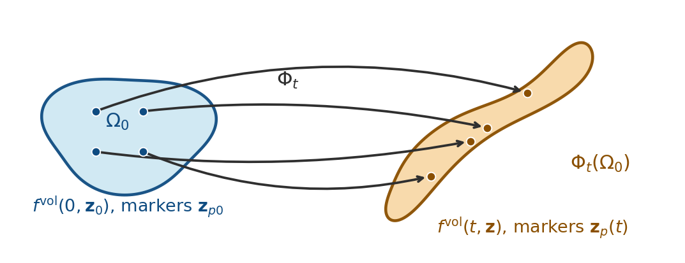
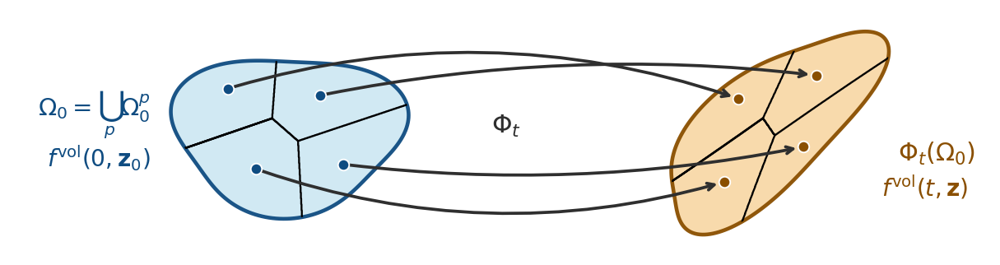
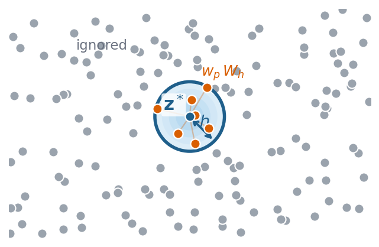
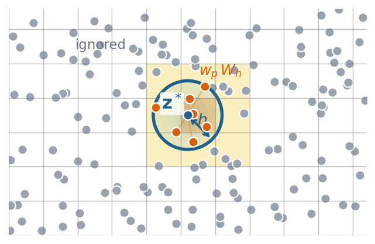

.. _particle_discrete:

Particle-in-cell methods (PIC)
------------------------------

This page introduces the particle-in-cell (PIC) method as it is used in Struphy.
The first sections explain the idea and the algorithm without proofs; the derivations follow in
:ref:`pic_eom`, :ref:`control_var` and the sections after them.
Parts of the material and the figures are adapted from the lecture
`Meshless Structure-Preserving Algorithms <https://github.com/spossann/2026_SPEGEO_Strasbourg_school>`_
(SPEGEO school, Strasbourg 2026).

.. _pic_overview:

Overview
^^^^^^^^

Kinetic equations describe a distribution function :math:`f(t, \mathbf z)` on phase space, where
:math:`\mathbf z \in \Omega \subset \mathbb R^n` collects positions and velocities
(:math:`n = 6` for full orbits, :math:`n=5` for guiding centers, :math:`n<6` in reduced test cases).
Most kinetic equations in Struphy are conservation laws of the form

.. math::
    :label: conservelaw

    \partial_t f^\textrm{vol} + \nabla_{\mathbf z} \cdot \big(\mathbf u(t, \mathbf z)\, f^\textrm{vol}\big) = S\,,
    \qquad f^\textrm{vol}(0, \mathbf z) = f^\textrm{vol}_\textnormal{in}(\mathbf z)\,,

where :math:`\mathbf u: \mathbb R \times \Omega \to \mathbb R^n` is the phase-space velocity (the characteristics of
the equation), :math:`S` is a source term (zero for the Vlasov equation, non-zero e.g. for collisions or for the
:ref:`delta-f method <pic_deltaf>`), and :math:`f^\textrm{vol}` is the distribution function as a *density*
(or *volume form*), whose integral over a region of phase space is the number of particles in that region
(see :ref:`pic_phase_space`).
For the Vlasov equation in Cartesian coordinates, for example, :math:`\mathbf z = (\mathbf x, \mathbf v)` and
:math:`\mathbf u = \big(\mathbf v, \tfrac{q}{m}(\mathbf E + \mathbf v \times \mathbf B)\big)`.

**The idea.** Instead of storing :math:`f^\textrm{vol}` on a grid in :math:`n` dimensions, PIC represents it by
:math:`N \gg 1` computational particles, called **markers**. Marker :math:`p` has a position
:math:`\mathbf z_p(t)` in phase space and a **weight** :math:`w_p(t)`, the amount of :math:`f^\textrm{vol}` it carries:

.. math::
    :label: pic:ansatz

    f^\textrm{vol}(t, \mathbf z) \approx f_h(t, \mathbf z) := \sum_{p=1}^N w_p(t)\, \delta\big(\mathbf z - \mathbf z_p(t)\big)\,.

Integrals against :math:`f^\textrm{vol}` (charge and current densities, energies, ...) become sums over markers,

.. math::

    \int_\Omega A(\mathbf z)\, f^\textrm{vol}(t, \mathbf z)\,\textrm d \mathbf z \approx \sum_{p=1}^N w_p(t)\, A\big(\mathbf z_p(t)\big)\,.

The markers move along the characteristics of :math:`\mathbf u`, i.e. with the flow map :math:`\Phi_t` of the equation
(:ref:`figure <fig:pic_flow_map>`),

.. math::

    \dot{\mathbf z}_p = \mathbf u(t, \mathbf z_p)\,, \qquad \mathbf z_p(0) = \mathbf z_{p0}\,,
    \qquad\Longleftrightarrow\qquad \mathbf z_p(t) = \Phi_t(\mathbf z_{p0})\,,

and without source term (:math:`S = 0`) **the weights stay constant**. The initial condition
:math:`f^\textrm{vol}_\textnormal{in}` enters only through the initial weights. All of this is shown in
:ref:`pic_eom`.

.. _fig:pic_flow_map:

    Markers :math:`\mathbf z_{p0}` in a region :math:`\Omega_0` are transported by the flow map :math:`\Phi_t`
    of the kinetic equation. The density :math:`f^\textrm{vol}` is transported with them; the number of particles
    in :math:`\Phi_t(\Omega_0)` is the same as in :math:`\Omega_0`.

In Struphy, the initial markers are usually drawn at random (Monte-Carlo loading) from a *sampling density* :math:`s^\textrm{vol}_\textnormal{in}`
(a probability density on :math:`\Omega`), and the initial weights are

.. math::
    :label: def:weights

    w_{p0} = \frac{1}{N}\,\frac{f^\textrm{vol}_\textnormal{in}(\mathbf z_{p0})}{s^\textrm{vol}_\textnormal{in}(\mathbf z_{p0})}\,.

This choice makes the marker sums Monte-Carlo estimates of the integrals, with an error that decreases like
:math:`1/\sqrt N` (see :ref:`monte_carlo`). Note that in Struphy the factor :math:`1/N` is part of the weights.

.. _pic_algo:

PIC algorithm
^^^^^^^^^^^^^

A PIC simulation in Struphy consists of the following steps:

1. **Loading.** Draw :math:`N \gg 1` markers :math:`\mathbf z_{p0}` from the sampling density
   :math:`s^\textrm{vol}_\textnormal{in}`, see :ref:`pic_loading`. Options:
   :class:`~struphy.particles.parameters.LoadingParameters`, implementation:
   :meth:`struphy.pic.base.Particles.draw_markers`.

2. **Initial weights.** Compute :math:`w_{p0}` from equation :math:numref:`def:weights`. The initial condition of
   the kinetic equation enters here. Options: :class:`~struphy.particles.parameters.WeightsParameters`,
   implementation: :meth:`struphy.pic.base.Particles.initialize_weights`.

3. **Time stepping.** In each time step, the propagators of the model (see :ref:`time_discret`)

   a. *push* the markers along the characteristics, :math:`\dot{\mathbf z}_p = \mathbf u(t, \mathbf z_p)`, where
      :math:`\mathbf u` may depend on the electromagnetic fields evaluated at the marker positions;
   b. update the weights, if there is a source term, a :ref:`control variate <control_var>` or a
      :ref:`delta-f <pic_deltaf>` formulation;
   c. *accumulate* marker sums on the finite element spaces (charge and current densities, particle
      contributions to matrices), see :ref:`pic_accum`;
   d. solve the field equations with these sources, see :ref:`geomFE`.

   With MPI, markers are distributed over the processes by their position in space and are moved to another
   process when they leave its domain (sorting).

4. **Diagnostics.** Compute scalar quantities (marker sums), and reconstruct distribution functions and
   densities on grids by :ref:`binning` or by :ref:`kernel density estimation <pic_kde>`.

PIC methods are popular for kinetic equations because

a. the Monte-Carlo error :math:`\sim 1/\sqrt N` does not depend on the dimension :math:`n` of phase space,
   while the cost of grids grows exponentially with :math:`n`;
b. markers move independently of each other, which makes PIC easy to parallelize;
c. the markers follow the characteristics exactly (up to the time integrator): there is no numerical diffusion
   and no CFL condition from phase-space advection (the time step is still limited by the accuracy and
   stability of the pusher and of the coupling to the fields).

The price is the slow convergence :math:`\sim 1/\sqrt N` and the associated noise in the simulations.
Noise reduction techniques such as the :ref:`control_var` and the :ref:`delta-f method <pic_deltaf>` are therefore
essential in many applications.

**Notation used on this page:**

.. list-table::
    :header-rows: 1
    :widths: 25 75

    * - Symbol
      - Meaning
    * - :math:`\mathbf z \in \Omega \subset \mathbb R^n`
      - phase-space coordinates; in Struphy :math:`\mathbf z = (\boldsymbol \eta, \mathbf v)` with logical
        coordinates :math:`\boldsymbol\eta \in (0, 1)^3` (6D), or :math:`(\boldsymbol\eta, v_\parallel, \mu)` (5D)
    * - :math:`f^\textrm{vol}`, :math:`f^0`
      - distribution function as a volume form (density) and as a 0-form (scalar),
        :math:`f^\textrm{vol} = J f^0`
    * - :math:`J(\mathbf z)`
      - Jacobian determinant of the phase-space coordinates, see :ref:`pic_phase_space`
    * - :math:`s^\textrm{vol}`, :math:`s^0`
      - sampling density of the markers (a probability density), :math:`s^\textrm{vol} = J s^0`
    * - :math:`N`, :math:`p`
      - number of markers, marker index
    * - :math:`\mathbf z_p(t)`, :math:`\mathbf z_{p0}`
      - marker position at time :math:`t` and at :math:`t=0`
    * - :math:`w_p(t)`, :math:`w_{p0}`
      - marker weight (including the factor :math:`1/N`) at time :math:`t` and at :math:`t=0`
    * - :math:`\Phi_t`
      - flow map of :math:`\dot{\mathbf z} = \mathbf u(t, \mathbf z)`, :math:`\Phi_t(\mathbf z_{p0}) = \mathbf z_p(t)`
    * - :math:`\mathcal M`
      - background (control variate), usually a Maxwellian

.. _pic_phase_space:

Phase space, 0-forms and volume forms
^^^^^^^^^^^^^^^^^^^^^^^^^^^^^^^^^^^^^

Struphy computes in logical coordinates :math:`\boldsymbol\eta \in (0,1)^3`, mapped to physical space by
:math:`\mathbf x = F(\boldsymbol\eta)` (see :ref:`geomFE`), and in velocity coordinates :math:`\mathbf v`
(Cartesian velocities in 6D, :math:`(v_\parallel, \mu)` in 5D). A phase-space volume element transforms as

.. math::

    \textrm d^3 \mathbf x\, \textrm d \mathbf v_\textnormal{phys} = J(\mathbf z)\, \textrm d \mathbf z\,,
    \qquad J(\mathbf z) = |\det DF(\boldsymbol\eta)|\, J_v(\mathbf z)\,,

where :math:`J_v` is the Jacobian determinant of the velocity coordinates (:math:`J_v = 1` for Cartesian
velocities, :math:`J_v = B_0` (up to constants) for :math:`(v_\parallel, \mu)`, see ``velocity_jacobian_det``
of the backgrounds in :mod:`struphy.kinetic_background.maxwellians`).

A distribution function can therefore be given in two ways:

* as a **0-form** :math:`f^0(t, \mathbf z)`: the value of the physical distribution function at the point
  :math:`\mathbf z`, independent of the coordinates;
* as a **volume form** (density) :math:`f^\textrm{vol} = J f^0`: the quantity whose integral
  :math:`\int f^\textrm{vol}\,\textrm d \mathbf z` over a region of logical phase space gives the number of
  particles in that region.

Kinetic backgrounds and initial conditions in Struphy are usually specified as 0-forms (e.g. Maxwellians), while
the conservation law :math:numref:`conservelaw` and the marker ansatz :math:numref:`pic:ansatz` are for the volume
form. The ratio of two volume forms equals the ratio of the corresponding 0-forms,

.. math::

    \frac{f^\textrm{vol}}{s^\textrm{vol}} = \frac{J f^0}{J s^0} = \frac{f^0}{s^0}\,,

which is why the weights :math:numref:`def:weights` can be computed from 0-forms; this is what
:meth:`~struphy.pic.base.Particles.initialize_weights` does.

**Transport of densities.** Without source, equation :math:numref:`conservelaw` conserves the number of particles
in every region that moves with the flow (:ref:`figure <fig:pic_flow_map>`):

.. math::

    \int_{\Phi_t(\Omega_0)} f^\textrm{vol}(t, \mathbf z)\,\textrm d \mathbf z = \int_{\Omega_0} f^\textrm{vol}(0, \mathbf z_0)\,\textrm d \mathbf z_0
    \qquad \forall\, \Omega_0 \subset \Omega\,.

Changing variables :math:`\mathbf z = \Phi_t(\mathbf z_0)` on the left and letting :math:`\Omega_0` shrink to a
point gives

.. math::
    :label: pic:transport_vol

    f^\textrm{vol}\big(t, \Phi_t(\mathbf z_0)\big) = \frac{f^\textrm{vol}(0, \mathbf z_0)}{\big|\det D\Phi_t(\mathbf z_0)\big|}\,.

The density changes along a trajectory only through the compression of phase-space volume. Since
:math:`\tfrac{\textrm d}{\textrm d t} \det D\Phi_t = (\nabla_{\mathbf z} \cdot \mathbf u)(t, \Phi_t)\, \det D\Phi_t`,
this is equivalent to

.. math::
    :label: pic:transport_vol_ode

    \frac{\textrm d}{\textrm d t} f^\textrm{vol}\big(t, \mathbf z_p(t)\big) = - f^\textrm{vol}\, \nabla_{\mathbf z} \cdot \mathbf u
    \qquad \textnormal{along}\quad \dot{\mathbf z}_p = \mathbf u(t, \mathbf z_p)\,.

**Liouville's theorem.** The Vlasov flow preserves the physical phase-space volume (the Lorentz force is
divergence-free in velocity space). In logical coordinates this means :math:`\nabla_{\mathbf z} \cdot (J \mathbf u) = 0`, i.e.
:math:`J\, \nabla_{\mathbf z} \cdot \mathbf u = - \mathbf u \cdot \nabla_{\mathbf z} J`. Then, from
:math:numref:`pic:transport_vol_ode`,

.. math::

    \frac{\textrm d}{\textrm d t} f^0\big(t, \mathbf z_p(t)\big)
    = \frac{\textrm d}{\textrm d t} \frac{f^\textrm{vol}}{J}
    = \frac{-f^\textrm{vol}\, \nabla_{\mathbf z} \cdot \mathbf u}{J} - \frac{f^\textrm{vol}}{J^2}\, \mathbf u \cdot \nabla_{\mathbf z} J
    = 0\,.

Hence **the 0-form is constant along the characteristics**, the familiar statement that the distribution function
is constant along particle orbits. The same holds for the sampling density :math:`s^0` (see :ref:`pic_eom`), which
is why Struphy evaluates :math:`s^0` only once, at loading, and stores it with each marker (column ``s0`` of the
marker array, see :class:`~struphy.pic.base.Particles`).

For guiding centers, the phase-space volume conserved by the flow is :math:`B^*_\parallel\, \textrm d v_\parallel\, \textrm d \mu`
(times the spatial volume), with the modified field :math:`B^*_\parallel = B_\parallel + O(\epsilon)` of
guiding-center theory. With Struphy's :math:`J_v = B_0`, the 0-forms :math:`f^0` and :math:`s^0` are therefore
constant along guiding-center orbits only up to the ratio :math:`B^*_\parallel / B_0 = 1 + O(\epsilon)`.

.. _monte_carlo:

Monte-Carlo integration
^^^^^^^^^^^^^^^^^^^^^^^

At the core of the PIC method is the approximation of integrals

.. math::
    :label: int:1

    I = \int_\Omega A(\mathbf z)\, f^\textrm{vol}(\mathbf z)\,\textrm d \mathbf z
      = \int_\Omega A(\mathbf z)\, f^0(\mathbf z)\, J(\mathbf z)\,\textrm d \mathbf z

by Monte-Carlo (MC) integration, where :math:`A` is a 0-form (e.g. a velocity moment times a finite element basis
function). Let :math:`s^\textrm{vol}` be a probability density on :math:`\Omega`,

.. math::

    s^\textrm{vol}(\mathbf z) > 0 \quad \forall\, \mathbf z \in \Omega\,, \qquad \int_\Omega s^\textrm{vol}(\mathbf z)\,\textrm d \mathbf z = 1\,.

Then :math:`I` is an expectation value :math:`\mathbb E` with respect to :math:`s^\textrm{vol}`:

.. math::
    :label: int:2

    I = \int_\Omega A\, \frac{f^\textrm{vol}}{s^\textrm{vol}}\, s^\textrm{vol}\,\textrm d \mathbf z
      = \mathbb E\left[ A\, \frac{f^\textrm{vol}}{s^\textrm{vol}} \right]_{s^\textrm{vol}}\,.

**Monte-Carlo estimate.** Draw :math:`N` independent samples :math:`\mathbf z_p \sim s^\textrm{vol}` and approximate
the expectation by the sample mean,

.. math::
    :label: mcint

    I \approx I_N := \frac 1N \sum_{p=1}^N A(\mathbf z_p)\, \frac{f^\textrm{vol}(\mathbf z_p)}{s^\textrm{vol}(\mathbf z_p)}
    = \sum_{p=1}^N w_p\, A(\mathbf z_p)\,, \qquad
    w_p = \frac 1N \frac{f^\textrm{vol}(\mathbf z_p)}{s^\textrm{vol}(\mathbf z_p)} = \frac 1N \frac{f^0(\mathbf z_p)}{s^0(\mathbf z_p)}\,.

This is the marker sum of the :ref:`pic_overview`, obtained equally by inserting the ansatz
:math:numref:`pic:ansatz` into :math:numref:`int:1`. In Struphy, MC integrals of the form :math:numref:`mcint` are
implemented by accumulators, see :ref:`pic_accum`.

**Error.** Viewing the samples as random variables, :math:`I_N` is itself a random variable. It is *unbiased*,

.. math::

    \mathbb E[I_N] = \frac 1N \sum_{p=1}^N \mathbb E\left[ A\, \frac{f^\textrm{vol}}{s^\textrm{vol}}\right]_{s^\textrm{vol}} = I\,,

and its variance, the mean squared error, follows from Bienaymé's identity
:math:`\mathbb V\big[\sum_p X_p\big] = \sum_p \mathbb V[X_p]` for independent random variables:

.. math::

    \mathbb V[I_N] = \mathbb E\big[(I_N - I)^2\big]
    = \frac{1}{N^2} \sum_{p=1}^N \mathbb V\left[ A\, \frac{f^\textrm{vol}}{s^\textrm{vol}}\right]
    = \frac{\sigma^2}{N}\,, \qquad
    \sigma^2 := \mathbb V\left[ A\, \frac{f^\textrm{vol}}{s^\textrm{vol}}\right]_{s^\textrm{vol}}\,.

Hence the root-mean-square error is

.. math::
    :label: mc:error

    \varepsilon_N := \sqrt{\mathbb E\big[(I_N - I)^2\big]} = \frac{\sigma}{\sqrt N}\,,

**independent of the dimension** :math:`n` of phase space. Quadrature rules of order :math:`k` with :math:`N`
points converge like :math:`N^{-k/n}`, which becomes slow for :math:`n = 5` or :math:`6`.

There are two ways to reduce the error at fixed :math:`N`, both by making :math:`\sigma` smaller:

* **Importance sampling:** choose :math:`s^\textrm{vol}` similar to :math:`|A| f^\textrm{vol}`, so that
  :math:`A f^\textrm{vol}/s^\textrm{vol}` varies little. In Struphy the velocities of the markers are drawn from a
  Gaussian whose mean and thermal velocity can be adapted to the distribution function, see :ref:`pic_loading`.
* **Control variates:** subtract a known part of :math:`f^\textrm{vol}` whose integral can be computed exactly,
  see :ref:`control_var`.

Quasi-random (low-discrepancy) samples such as Sobol sequences can also improve the convergence rate beyond
:math:`1/\sqrt N` for smooth integrands; they are available as loading options.

.. _pic_two_ways:

Two ways to define markers and weights
^^^^^^^^^^^^^^^^^^^^^^^^^^^^^^^^^^^^^^

The ansatz :math:numref:`pic:ansatz` can be reached in two ways, which differ only in how the initial markers and
weights are chosen.

**Partition of phase space.** Divide the initial region into small subregions
:math:`\Omega_0 = \bigcup_p \Omega_0^p`, place one marker :math:`\mathbf z_{p0} \in \Omega_0^p` in each of them,
and give it the number of particles of its subregion as weight (:ref:`figure <fig:pic_partition>`),

.. math::

    w_p := \int_{\Omega_0^p} f^\textrm{vol}(0, \mathbf z_0)\,\textrm d \mathbf z_0\,,
    \qquad \sum_{p=1}^N w_p = \int_{\Omega_0} f^\textrm{vol}(0, \mathbf z_0)\,\textrm d \mathbf z_0\,.

The subregions are transported by the flow, :math:`\Omega_0^p \mapsto \Phi_t(\Omega_0^p)`, each keeping its number of
particles, and so does the marker inside: :math:`\mathbf z_p(t) = \Phi_t(\mathbf z_{p0}) \in \Phi_t(\Omega_0^p)`.
Approximating each subregion by its marker gives :math:numref:`pic:ansatz` with constant weights. The discrete
:math:`f_h` is still a density with the exact total number of particles,
:math:`\int f_h\, \textrm d \mathbf z = \sum_p w_p`.

.. _fig:pic_partition:

    Partition of the initial region into subregions :math:`\Omega_0^p` with one marker each. The flow map
    transports the subregions together with their markers; each subregion keeps its number of particles
    :math:`w_p`.

**Monte-Carlo sampling.** Draw the markers at random from a sampling density, :math:`\mathbf z_{p0} \sim s^\textrm{vol}_\textnormal{in}`,
and define the weights by :math:numref:`def:weights`, as described in :ref:`monte_carlo`.

.. list-table::
    :header-rows: 1
    :widths: 16 42 42

    * -
      - Partition of phase space
      - Monte-Carlo sampling
    * - Markers
      - one marker per subregion, :math:`\mathbf z_{p0} \in \Omega_0^p`; markers are placed regularly
      - drawn at random, :math:`\mathbf z_{p0} \sim s^\textrm{vol}_\textnormal{in}`
    * - Weights
      - :math:`w_p = \int_{\Omega_0^p} f^\textrm{vol}_\textnormal{in}\,\textrm d \mathbf z_0`
      - :math:`w_p = \dfrac 1N \dfrac{f^\textrm{vol}_\textnormal{in}(\mathbf z_{p0})}{s^\textrm{vol}_\textnormal{in}(\mathbf z_{p0})}`
    * - Comments
      - needs quadrature over the subregions; little noise initially, but markers become irregular in time
      - noisy, but with the provable convergence :math:`\sigma/\sqrt N` of integrals
    * - In Struphy
      - ``loading="tesselation"`` (used mainly for :ref:`SPH <sph_method>`)
      - ``loading="pseudo_random"``, ``"sobol_standard"``, ``"sobol_antithetic"``

In both cases the markers follow the flow and, without source, the weights are constant.

.. _pic_loading:

Marker loading in Struphy
^^^^^^^^^^^^^^^^^^^^^^^^^

Loading is configured with :class:`~struphy.particles.parameters.LoadingParameters` and done in
:meth:`struphy.pic.base.Particles.draw_markers`. The main options are:

* **Number of markers:** ``Np`` (total), or ``ppc`` (per cell of the grid) or ``ppb`` (per sorting box).
* **Loading algorithm** (``loading``):

  * ``"pseudo_random"``: independent pseudo-random samples (reproducible with ``seed``);
  * ``"sobol_standard"``: quasi-random Sobol sequence;
  * ``"sobol_antithetic"``: Sobol points, each mirrored into 64 symmetric markers (only for 3 velocity
    dimensions), which removes odd moments of the sampling error;
  * ``"tesselation"``: markers on a regular grid of tiles in each sorting box, with weights equal to the
    integrals of :math:`f^\textrm{vol}_\textnormal{in}` over the tiles, computed by Gauss-Legendre quadrature
    (``n_quad`` points), see :ref:`pic_two_ways`;
  * ``"restart"`` / ``"external"``: read markers from a restart file or an external HDF5 file.

* **Specific markers** (``specific_markers``): after loading, the first markers are replaced by markers at given
  phase-space points (e.g. for orbit tests).

For the Monte-Carlo algorithms the sampling density is a product of a spatial part and a Gaussian in velocity,

.. math::

    s^\textrm{vol}_\textnormal{in}(\boldsymbol\eta, \mathbf v) = n^3(\boldsymbol\eta)\, \mathcal G(\mathbf v)\,,
    \qquad
    \mathcal G(\mathbf v) = \prod_{i=1}^{d_v} \frac{1}{\sqrt{2\pi}\, v_{\textrm{th},i}}
    \exp\left[-\frac{(v_i - u_i)^2}{2 v_{\textrm{th},i}^2}\right]\,,

where :math:`d_v` is the dimension of velocity space. The shifts :math:`u_i` and thermal velocities
:math:`v_{\textrm{th},i}` are given by ``moments``; the default is :math:`u_i = 0` and
:math:`v_{\textrm{th},i} = 1`. Adapting them to the distribution function reduces the noise (importance sampling,
see :ref:`monte_carlo`). The spatial part is a normalized 3-form on the unit cube, chosen with
``spatial``: ``"uniform"`` gives :math:`n^3 = 1`, ``"disc"`` gives :math:`n^3 = 2\eta_1`, which is uniform on the
image of the unit square under a polar (disc) mapping. Velocities are drawn by inverse transform sampling, see
:meth:`~struphy.pic.base.Particles.draw_markers` for details, also for guiding-center markers.

After loading, :meth:`~struphy.pic.base.Particles.initialize_weights` computes the 0-form :math:`s^0_\textnormal{in}`
and the initial weights :math:`w_{p0}` at the markers. With ``reject_weights=True`` in
:class:`~struphy.particles.parameters.WeightsParameters`, markers with weights below ``threshold`` are removed.

.. _pic_eom:

Marker equations of motion
^^^^^^^^^^^^^^^^^^^^^^^^^^

We now derive the equations for :math:`\mathbf z_p(t)` and :math:`w_p(t)` from the conservation law
:math:numref:`conservelaw` with a general source :math:`S`. Three derivations are given: a short one from the weak
form (:ref:`pic_eom_weak`), a longer one based on Monte-Carlo estimates of each term (:ref:`pic_eom_mc`), and a
geometric argument for constant weights (:ref:`pic_eom_flow`). They lead to the same result.

Throughout, :math:`\frac{\textrm d}{\textrm d t} g\big(t, \mathbf z_p(t)\big) = \partial_t g + \dot{\mathbf z}_p \cdot \nabla_{\mathbf z} g`
denotes the time derivative of a function :math:`g` along a marker trajectory. Boundary terms are assumed to vanish.
The **weak form** of :math:numref:`conservelaw` reads

.. math::
    :label: pic:weak

    \frac{\textrm d}{\textrm d t} \int_\Omega f^\textrm{vol}\, \varphi\,\textrm d \mathbf z
    = \int_\Omega f^\textrm{vol}\, \mathbf u \cdot \nabla_{\mathbf z} \varphi\,\textrm d \mathbf z
    + \int_\Omega S\, \varphi\,\textrm d \mathbf z
    \qquad \forall\, \varphi \in C^\infty_c(\Omega)\,.

The time derivative of the marker sum, for any test function :math:`\varphi`, is

.. math::
    :label: int_fh

    \frac{\textrm d}{\textrm d t} \int_\Omega f_h\, \varphi\,\textrm d \mathbf z
    = \frac{\textrm d}{\textrm d t} \sum_{p=1}^N w_p\, \varphi(\mathbf z_p)
    = \sum_{p=1}^N \Big[ \dot w_p\, \varphi(\mathbf z_p) + w_p\, \dot{\mathbf z}_p \cdot \nabla_{\mathbf z} \varphi(\mathbf z_p) \Big]\,.

.. _pic_eom_weak:

Derivation from the weak form
"""""""""""""""""""""""""""""

We ask that :math:`f_h` satisfies the weak form :math:numref:`pic:weak` up to a Monte-Carlo error. Inserting
:math:`f_h` into the right-hand side of :math:numref:`pic:weak`, the transport term is evaluated **exactly**,

.. math::

    \int_\Omega f_h\, \mathbf u \cdot \nabla_{\mathbf z} \varphi\,\textrm d \mathbf z = \sum_{p=1}^N w_p\, \mathbf u(t, \mathbf z_p) \cdot \nabla_{\mathbf z}\varphi(\mathbf z_p)\,.

Only the source term needs an approximation. The markers at time :math:`t` are samples of a density
:math:`s^\textrm{vol}(t)` (the initial sampling density transported by the marker motion, see below), so
by :ref:`monte_carlo`

.. math::

    \int_\Omega S\, \varphi\,\textrm d \mathbf z \approx \frac 1N \sum_{p=1}^N \frac{S(t, \mathbf z_p)}{s^\textrm{vol}(t, \mathbf z_p)}\, \varphi(\mathbf z_p)\,.

Comparing with :math:numref:`int_fh` term by term (a sufficient condition for all :math:`\varphi`), we obtain

.. math::
    :label: def:dot_qw

    \dot{\mathbf z}_p &= \mathbf u(t, \mathbf z_p)\,, \qquad \mathbf z_p(0) = \mathbf z_{p0}\,,
    \\[2mm]
    \dot w_p &= \frac 1N\, \frac{S(t, \mathbf z_p)}{s^\textrm{vol}(t, \mathbf z_p)}\,, \qquad w_p(0) = w_{p0}\,.

**The sampling density.** The markers are drawn from :math:`s^\textrm{vol}_\textnormal{in}` and then move with
:math:`\dot{\mathbf z}_p = \mathbf u`. Their density at time :math:`t` is therefore the transported density,
the solution of

.. math::
    :label: s_eq

    \partial_t s^\textrm{vol} + \nabla_{\mathbf z} \cdot \big(\mathbf u\, s^\textrm{vol}\big) = 0\,,
    \qquad s^\textrm{vol}(0) = s^\textrm{vol}_\textnormal{in}\,,

which stays normalized to 1. Along a trajectory it is given by :math:numref:`pic:transport_vol`:
:math:`s^\textrm{vol}(t, \mathbf z_p(t)) = s^\textrm{vol}_\textnormal{in}(\mathbf z_{p0}) / |\det D\Phi_t(\mathbf z_{p0})|`.
For a Liouville flow (:ref:`pic_phase_space`) the 0-form :math:`s^0 = s^\textrm{vol}/J` is constant along
trajectories, so that the weight equation becomes

.. math::
    :label: pic:eqs

    \dot w_p = \frac 1N\, \frac{S^0(t, \mathbf z_p)}{s^0_\textnormal{in}(\mathbf z_{p0})}\,, \qquad S^0 := S / J\,,

with :math:`s^0_\textnormal{in}(\mathbf z_{p0})` stored per marker. Without source, **the weights are constant**,
:math:`w_p(t) = w_{p0}`.

**Consistency.** The relation :math:numref:`def:weights` remains true at all times:
:math:`w_p(t) = \frac 1N f^\textrm{vol}(t, \mathbf z_p)/s^\textrm{vol}(t, \mathbf z_p)`. Indeed, using
:math:numref:`pic:transport_vol_ode` with the source, :math:`\frac{\textrm d}{\textrm d t} f^\textrm{vol} = S - f^\textrm{vol} \nabla_{\mathbf z} \cdot \mathbf u`,
and :math:`\frac{\textrm d}{\textrm d t} s^\textrm{vol} = - s^\textrm{vol} \nabla_{\mathbf z} \cdot \mathbf u`,

.. math::

    \frac{\textrm d}{\textrm d t} \frac{f^\textrm{vol}}{s^\textrm{vol}}
    = \frac{S - f^\textrm{vol} \nabla_{\mathbf z} \cdot \mathbf u}{s^\textrm{vol}} + \frac{f^\textrm{vol}}{s^\textrm{vol}} \nabla_{\mathbf z} \cdot \mathbf u
    = \frac{S}{s^\textrm{vol}} = N \dot w_p\,.

Note that the source :math:`S` usually depends on :math:`f` itself (e.g. collisions) or on fields; it is then
evaluated from the markers or from the fields at the marker positions, see the :ref:`pic_deltaf` for an example.

.. _pic_eom_mc:

Derivation via Monte-Carlo estimates
""""""""""""""""""""""""""""""""""""

This derivation replaces *every* integral in the weak form by its Monte-Carlo estimate, instead of only the
source term. It starts from the requirement

.. math::
    :label: pic:principle

    \frac{\textrm d}{\textrm d t} \int_\Omega (f^\textrm{vol} - f_h)\, \varphi\,\textrm d \mathbf z = O(N^{-1/2})
    \qquad \forall\, \varphi \in C^\infty_c(\Omega)\,.

The time derivative of the :math:`f_h`-integral is :math:numref:`int_fh`. The time derivative of the
:math:`f^\textrm{vol}`-integral is given by the weak form :math:numref:`pic:weak`. Let :math:`s^\textrm{vol}(t)`
be a time-dependent probability density from which the markers :math:`\mathbf z_p(t)` are samples at each time
:math:`t`. Then both integrals in :math:numref:`pic:weak` are expectation values with respect to
:math:`s^\textrm{vol}`, which we estimate from the markers:

.. math::
    :label: expectvals

    \int_\Omega f^\textrm{vol}\, \mathbf u \cdot \nabla_{\mathbf z} \varphi\,\textrm d \mathbf z
    &= \mathbb E\left[\frac{f^\textrm{vol}}{s^\textrm{vol}}\,\mathbf u \cdot \nabla_{\mathbf z} \varphi \right]_{s^\textrm{vol}}
    = \frac 1N \sum_{p=1}^N \frac{f^\textrm{vol}(t, \mathbf z_p)}{s^\textrm{vol}(t, \mathbf z_p)}\,\mathbf u(t, \mathbf z_p) \cdot \nabla_{\mathbf z} \varphi(\mathbf z_p) + O(N^{-1/2})\,,
    \\[2mm]
    \int_\Omega S\, \varphi\,\textrm d \mathbf z
    &= \mathbb E\left[\frac{S}{s^\textrm{vol}}\, \varphi \right]_{s^\textrm{vol}}
    = \frac 1N \sum_{p=1}^N \frac{S(t, \mathbf z_p)}{s^\textrm{vol}(t, \mathbf z_p)}\, \varphi(\mathbf z_p) + O(N^{-1/2})\,.

Comparing the coefficients of :math:`\varphi(\mathbf z_p)` and :math:`\nabla_{\mathbf z} \varphi(\mathbf z_p)`
with :math:numref:`int_fh` (a sufficient condition for :math:numref:`pic:principle`) gives

.. math::

    w_p\, \dot{\mathbf z}_p &= \frac 1N \frac{f^\textrm{vol}(t, \mathbf z_p)}{s^\textrm{vol}(t, \mathbf z_p)}\,\mathbf u(t, \mathbf z_p)\,,
    \\[2mm]
    \dot w_p &= \frac 1N \frac{S(t, \mathbf z_p)}{s^\textrm{vol}(t, \mathbf z_p)}\,.

These are two equations for three unknowns (:math:`\mathbf z_p`, :math:`w_p` and :math:`s^\textrm{vol}`). We close
them by *defining* the weights as (assuming :math:`f^\textrm{vol} \neq 0` at the markers, so that we can divide by
:math:`w_p` and :math:`f^\textrm{vol}` below)

.. math::
    :label: def:weights_t

    w_p(t) := \frac 1N \frac{f^\textrm{vol}(t, \mathbf z_p(t))}{s^\textrm{vol}(t, \mathbf z_p(t))}\,,

which implies the same marker equations as before,

.. math::

    \dot{\mathbf z}_p &= \mathbf u(t, \mathbf z_p)\,,
    \\[2mm]
    \dot w_p &= \frac 1N \frac{S(t, \mathbf z_p)}{s^\textrm{vol}(t, \mathbf z_p)}\,.

The definition :math:numref:`def:weights_t` also implies, by differentiating along the trajectory,

.. math::

    \dot w_p = \frac 1N \left[ \frac{1}{s^\textrm{vol}} \frac{\textrm d f^\textrm{vol}}{\textrm d t} - \frac{f^\textrm{vol}}{(s^\textrm{vol})^2}\, \frac{\textrm d s^\textrm{vol}}{\textrm d t} \right]\,,

where all functions are evaluated at :math:`(t, \mathbf z_p(t))`. Comparing the two expressions for
:math:`\dot w_p` yields the equation that the sampling density must satisfy along the trajectories,

.. math::

    \frac{\textrm d s^\textrm{vol}}{\textrm d t} = \frac{s^\textrm{vol}}{f^\textrm{vol}} \left[ \frac{\textrm d f^\textrm{vol}}{\textrm d t} - S \right]\,.

From the conservation law :math:numref:`conservelaw`, :math:`\frac{\textrm d f^\textrm{vol}}{\textrm d t} = S - f^\textrm{vol}\, \nabla_{\mathbf z} \cdot \mathbf u`,
hence

.. math::

    \frac{\textrm d s^\textrm{vol}}{\textrm d t} = - s^\textrm{vol}\, \nabla_{\mathbf z} \cdot \mathbf u\,,

which is the transport equation :math:numref:`s_eq` for :math:`s^\textrm{vol}`. The PIC solution is therefore
obtained by solving

.. math::
    :label: pic:eqs:compressible

    \dot{\mathbf z}_p &= \mathbf u(t, \mathbf z_p)\,, \qquad \mathbf z_p(0) = \mathbf z_{p0} \sim s^\textrm{vol}_\textnormal{in}\,,
    \\[2mm]
    \dot w_p &= \frac 1N \frac{S(t, \mathbf z_p)}{s^\textrm{vol}(t, \mathbf z_p)}\,, \qquad w_p(0) = \frac 1N \frac{f^\textrm{vol}_\textnormal{in}(\mathbf z_{p0})}{s^\textrm{vol}_\textnormal{in}(\mathbf z_{p0})}\,,

with :math:`s^\textrm{vol}(t, \mathbf z_p(t)) = s^\textrm{vol}_\textnormal{in}(\mathbf z_{p0}) \exp\big(-\int_0^t \nabla_{\mathbf z} \cdot \mathbf u(\tau, \mathbf z_p(\tau))\,\textrm d \tau\big)`.
For incompressible flow, :math:`\nabla_{\mathbf z} \cdot \mathbf u = 0`, the sampling density is constant along
the trajectories and :math:`s^\textrm{vol}(t, \mathbf z_p(t)) = s^\textrm{vol}_\textnormal{in}(\mathbf z_{p0})`;
for Liouville flows the same holds for the 0-form :math:`s^0`, which gives :math:numref:`pic:eqs`.

.. _pic_eom_flow:

Constant weights from the flow map
""""""""""""""""""""""""""""""""""

Without source, constancy of the weights follows directly from the transport of densities
:math:numref:`pic:transport_vol`. Both :math:`f^\textrm{vol}` and the sampling density :math:`s^\textrm{vol}` are
transported by the same flow map, :math:`\mathbf z_p(t) = \Phi_t(\mathbf z_{p0})`, so that the Jacobian
determinants cancel in the weights :math:numref:`def:weights_t`:

.. math::

    w_p(t) = \frac 1N \frac{f^\textrm{vol}(t, \mathbf z_p(t))}{s^\textrm{vol}(t, \mathbf z_p(t))}
    = \frac 1N \frac{f^\textrm{vol}_\textnormal{in}(\mathbf z_{p0}) / |\det D\Phi_t(\mathbf z_{p0})|}{s^\textrm{vol}_\textnormal{in}(\mathbf z_{p0}) / |\det D\Phi_t(\mathbf z_{p0})|}
    = w_{p0}\,.

The information on the initial condition is encoded in the constant weights, and the markers just follow the flow.

**Comparison.** The derivation from the weak form (:ref:`pic_eom_weak`) treats the transport term exactly and
needs Monte-Carlo only for the source term; the relation :math:`w_p = f^\textrm{vol}/(N s^\textrm{vol})` and the
transport of :math:`s^\textrm{vol}` are *results*. The derivation via Monte-Carlo estimates
(:ref:`pic_eom_mc`) approximates the transport term as well and needs the weights :math:numref:`def:weights_t` as
an additional *definition* to close the equations; the transport of :math:`s^\textrm{vol}` then follows as a
consistency condition. The flow-map argument is the most direct, but covers only the source-free case.

.. _control_var:

Control variate method
^^^^^^^^^^^^^^^^^^^^^^

The Monte-Carlo error :math:numref:`mc:error` is proportional to the standard deviation :math:`\sigma` of the
integrand. In many plasma applications, :math:`f` stays close to a known background :math:`\mathcal M` (e.g. a
Maxwellian equilibrium), and only the small deviation :math:`f - \mathcal M` carries the interesting physics. The
control variate method exploits this. It relies on

1. the ability to compute the integral :math:numref:`int:1` of the background without Monte-Carlo
   (analytically or by quadrature):

   .. math::

       I_{\mathcal M} := \int_\Omega A\, \mathcal M^\textrm{vol}\,\textrm d \mathbf z = \int_\Omega A\, \mathcal M^0\, J\,\textrm d \mathbf z\,;

2. the assumption that :math:`f(t)` is close to :math:`\mathcal M(t)` for all :math:`t`.

Then :math:numref:`int:1` is decomposed as

.. math::

    I &= \int_\Omega A\, (f^\textrm{vol} - \mathcal M^\textrm{vol})\,\textrm d \mathbf z + I_{\mathcal M}
    \\[2mm]
    &= \int_\Omega A\, \frac{f^\textrm{vol} - \mathcal M^\textrm{vol}}{s^\textrm{vol}}\, s^\textrm{vol}\,\textrm d \mathbf z + I_{\mathcal M}
    \\[2mm]
    &\approx \sum_{p=1}^N w_p^\delta(t)\, A\big(t, \mathbf z_p(t)\big) + I_{\mathcal M}\,,

with the time-dependent **delta-f weights**

.. math::
    :label: pic:cv_weights

    w^\delta_p(t) = \frac 1N \frac{f^\textrm{vol} - \mathcal M^\textrm{vol}}{s^\textrm{vol}}\Big|_{(t, \mathbf z_p(t))}
    = w_{p0} - \frac 1N \frac{\mathcal M^0\big(t, \mathbf z_p(t)\big)}{s^0_\textnormal{in}(\mathbf z_{p0})}\,.

For the second equality we used that, without source, :math:`f^0/s^0 = N w_{p0}` and :math:`s^0` are constant along
the trajectories (:ref:`pic_eom`; for guiding centers up to :math:`O(\epsilon)`, see :ref:`pic_phase_space`).
The full-f weights :math:`w_{p0}` stay constant; the delta-f weights are
recomputed from them whenever the markers have moved. The variance is now

.. math::

    \sigma^2_\delta = \mathbb V\left[ A\, \frac{f^\textrm{vol} - \mathcal M^\textrm{vol}}{s^\textrm{vol}}\right]_{s^\textrm{vol}}\,,

which is small when :math:`f \approx \mathcal M`: for a perturbation of relative size :math:`\epsilon`, the noise is
reduced by roughly a factor :math:`\epsilon`, which would otherwise need :math:`1/\epsilon^2` times more markers.

In Struphy, the control variate is switched on with ``control_variate=True`` in
:class:`~struphy.particles.parameters.WeightsParameters`; the background :math:`\mathcal M` is the background of the
species (:attr:`~struphy.pic.base.Particles.f0`). The weights :math:numref:`pic:cv_weights` are computed in
:meth:`struphy.pic.base.Particles.update_weights`, which the propagators call after pushing the markers. The marker
array stores both: ``w0`` (:math:`w_{p0}`) and ``weights`` (:math:`w^\delta_p`).

.. _pic_deltaf:

Delta-f method
^^^^^^^^^^^^^^

The control variate method solves the full equation for :math:`f` and only changes how integrals are estimated. In
the **delta-f method**, the markers instead solve an equation for the perturbation :math:`\delta f = f - \mathcal M`
directly. Writing the characteristics as :math:`\mathbf u = \mathbf u_0 + \mathbf u_1`, where the background is
stationary under :math:`\mathbf u_0`, i.e. :math:`\nabla_{\mathbf z} \cdot (\mathbf u_0 \mathcal M^\textrm{vol}) = 0`,
the conservation law :math:numref:`conservelaw` (with :math:`S = 0`) becomes

.. math::

    \partial_t \delta f^\textrm{vol} + \nabla_{\mathbf z} \cdot \big(\mathbf u\, \delta f^\textrm{vol}\big)
    = - \nabla_{\mathbf z} \cdot \big(\mathbf u_1 \mathcal M^\textrm{vol}\big)\,.

This is again of the form :math:numref:`conservelaw`, now for :math:`\delta f^\textrm{vol}` with the source
:math:`S = - \nabla_{\mathbf z} \cdot (\mathbf u_1 \mathcal M^\textrm{vol})`. The marker equations of
:ref:`pic_eom` apply: the markers follow the characteristics, and the weights
:math:`w_p \approx \delta f^\textrm{vol}/(N s^\textrm{vol})` evolve by :math:numref:`pic:eqs`. In a *linearized*
model, :math:`\mathbf u` is replaced by :math:`\mathbf u_0` on the left-hand side.

**Example: linearized Vlasov-Ampère.** For a uniform Maxwellian background
:math:`\mathcal M^0 \propto \exp\big(-|\mathbf v|^2/(2 v_\textrm{th}^2)\big)` and the electric force
:math:`\mathbf u_1 = (0, \tfrac{q}{m} \mathbf E)`, we have :math:`\nabla_{\mathbf v} \cdot \mathbf u_1 = 0` and
:math:`\nabla_{\mathbf v} \mathcal M^0 = - \mathbf v\, \mathcal M^0 / v_\textrm{th}^2`, hence the source
:math:`S^0 = \tfrac{q}{m v_\textrm{th}^2}\, \mathbf E \cdot \mathbf v\, \mathcal M^0` and

.. math::

    \dot w_p = \frac 1N\, \frac{q}{m v_\textrm{th}^2}\, \frac{\mathcal M^0(\mathbf z_p)}{s^0_\textnormal{in}(\mathbf z_{p0})}\, \mathbf E(\boldsymbol \eta_p) \cdot \mathbf v_p\,.

In Struphy, delta-f markers are :class:`~struphy.pic.particles.DeltaFParticles6D`, used by
:class:`~struphy.models.LinearVlasovAmpereOneSpecies` and :class:`~struphy.models.LinearVlasovMaxwellOneSpecies`.
Their initial weights are computed from the perturbation of the initial condition only, and the weight equation
above (in normalized units) is solved, coupled to the electric field, in
:class:`~struphy.propagators.efield_weights_coupling.EfieldWeightsCoupling`.

.. _pic_accum:

Particle-to-grid coupling (accumulation)
^^^^^^^^^^^^^^^^^^^^^^^^^^^^^^^^^^^^^^^^

Kinetic species couple to the fields through velocity moments of :math:`f`, such as the charge density
:math:`\rho = q \int f\,\textrm d \mathbf v` or the current density :math:`\mathbf j = q \int \mathbf v f\,\textrm d \mathbf v`.
In the finite element discretization (see :ref:`geomFE`) these moments appear tested with basis functions
:math:`\Lambda_i`. In logical coordinates, for example,

.. math::

    \int \rho\, \Lambda^0_i\,\textrm d^3 \mathbf x
    = q \int_\Omega f^\textrm{vol}(\boldsymbol \eta, \mathbf v)\, \Lambda^0_i(\boldsymbol\eta)\,\textrm d \mathbf z
    \approx q \sum_{p=1}^N w_p\, \Lambda^0_i(\boldsymbol\eta_p)\,,

which is a Monte-Carlo integral :math:numref:`mcint` with :math:`A = \Lambda^0_i`. In general, particle
contributions to vectors and matrices have the form

.. math::

    V_i = \sum_{p=1}^N w_p\, B_p\, \Lambda_i(\boldsymbol\eta_p)\,, \qquad
    M_{ij} = \sum_{p=1}^N w_p\, B_p\, \Lambda_i(\boldsymbol\eta_p)\, \Lambda_j(\boldsymbol\eta_p)\,,

with a *filling* :math:`B_p` depending on the marker (e.g. its velocity and the metric at its position). Since only
the basis functions that are non-zero at :math:`\boldsymbol\eta_p` contribute, the cost is :math:`O(N)`. These sums
are computed by the accumulators (:class:`~struphy.pic.accumulation.particles_to_grid.AccumulatorVector`,
:class:`~struphy.pic.accumulation.particles_to_grid.Accumulator` and the matrix-free
:class:`~struphy.pic.accumulation.particles_to_grid.MarkerOperator`), see the :ref:`dev_reference` for details. The weights
already contain the factor :math:`1/N`; with the control variate or the delta-f method, :math:`w_p` is the delta-f
weight. The opposite direction, fields evaluated at the marker positions in the pushers, uses the same basis
functions.

.. _binning:

Particle binning
^^^^^^^^^^^^^^^^

The aim of particle binning is to obtain a grid representation of the distribution function, which is represented
by markers in Struphy. The approximation is obtained by integrating over small volumes of phase space, called
"bins". These bins are not necessarily related to the FE grid used for the fields (but they can be). Moreover, bins
do not have to be defined in all :math:`n` directions of phase space; one can do 1D or 2D binning, integrating over
the other coordinates.

For example, let us bin in the :math:`(\eta_1, v_1)` plane of the phase space :math:`\mathbf z = (\boldsymbol\eta, \mathbf v) \in (0,1)^3 \times \mathbb R^3`.
We want an approximation of the *reduced* 2D density

.. math::

    f^\textnormal{red}(t, \eta_1, v_1) := \int_{(0, 1)^2}\int_{\mathbb R^2} g(t, \boldsymbol\eta, \mathbf v)\,\textrm d \eta_2\, \textrm d \eta_3\, \textrm d v_2\, \textrm dv_3\,,

where :math:`g` is either the volume form :math:`f^\textrm{vol}` or the distribution function per logical volume,
:math:`f^\textrm{vol}/|\det DF|` (which equals the 0-form :math:`f^0` for Cartesian velocities). Note that the
reduced function depends on the choice of coordinates (it is not invariant); it is still a useful picture of the
distribution function. Given bin edges :math:`(\eta_{1,i})_i` and :math:`(v_{1,j})_j`, we approximate
:math:`f^\textnormal{red}` on a bin :math:`\Omega_{ij} = (\eta_{1,i}, \eta_{1,i+1}) \times (v_{1,j}, v_{1,j+1})` by its
mean value over that bin:

.. math::
    :label: f_approx

    f^\textnormal{red}(t, \eta_1, v_1)\Big|_{\Omega_{ij}} \approx R_{ij}(t) := \frac{1}{|\Omega_{ij}|} \int_{\Omega_{ij}} f^\textnormal{red}(t, \eta_1, v_1)\,\textrm d\eta_1\, \textrm d v_1\,,
    \qquad |\Omega_{ij}| = (\eta_{1,i+1} - \eta_{1,i})(v_{1,j+1} - v_{1,j})\,.

:math:`R_{ij}` has the same dimension as :math:`f^\textnormal{red}`, due to the one-over-volume prefactor. With the
indicator function :math:`\chi_{ij}(\eta_1, v_1)` of the bin (1 inside :math:`\Omega_{ij}`, 0 otherwise),
:math:`R_{ij}` is a Monte-Carlo integral :math:numref:`mcint`:

.. math::
    :label: def:Rij

    R_{ij}(t) = \frac{1}{|\Omega_{ij}|} \int_\Omega \chi_{ij}(\eta_1, v_1)\, \frac{g}{f^\textrm{vol}}\, f^\textrm{vol}\,\textrm d \mathbf z
    \approx \frac{1}{|\Omega_{ij}|} \sum_{p\,:\, \mathbf z_p \in \Omega_{ij}} w_p\, \frac{g}{f^\textrm{vol}}(\mathbf z_p)\,,

where the sum runs over all markers in the bin, and :math:`g/f^\textrm{vol}` is 1 or :math:`1/|\det DF(\boldsymbol\eta_p)|`.
This is a weighted histogram of the markers.

In Struphy, binning is done by :meth:`struphy.pic.base.Particles.binning`, configured with
:class:`~struphy.particles.parameters.BinningPlot`. It returns two histograms: the **full-f** histogram with the
initial weights :math:`w_{p0}` (which represent :math:`f` when there is no source), and the **delta-f** histogram with
the current weights :math:`w_p` (equal to :math:`w_{p0}` without control variate, the delta-f weights
:math:numref:`pic:cv_weights` with control variate). For :ref:`delta-f markers <pic_deltaf>`, both histograms
represent the perturbation: the initial weights carry :math:`\delta f_\textnormal{in}` and the current weights
:math:`\delta f(t)`. ``divide_by_jac=True`` (default) selects :math:`g = f^\textrm{vol}/|\det DF|`; only the spatial
Jacobian is divided out, so for guiding-center markers :math:`g = J_v f^0`.
Besides the density, velocity moments can be binned by multiplying the weights with :math:`v_i`
(``"current"``), :math:`v_i v_j` (``"energy_tensor"``) or :math:`|\mathbf v|^2 v_i` (``"heat_flux"``).

.. _pic_kde:

Kernel density estimation
^^^^^^^^^^^^^^^^^^^^^^^^^

The marker approximation :math:numref:`pic:ansatz` is a sum of delta distributions, while the true solution is
smooth. A smooth approximation that can be evaluated at any point is obtained by convolution with a **smoothing
kernel** :math:`W_h` of width :math:`h` (e.g. a Gaussian), normalized to :math:`\int W_h\, \textrm d \mathbf z = 1`:

.. math::

    \tilde f_h(t, \mathbf z) := (W_h * f_h)(t, \mathbf z) = \int_\Omega W_h(\mathbf z - \mathbf z')\, f_h(t, \mathbf z')\,\textrm d \mathbf z'
    = \sum_{p=1}^N w_p\, W_h\big(\mathbf z - \mathbf z_p(t)\big)\,.

If :math:`W_h` vanishes outside a ball of radius :math:`h`, only markers within distance :math:`h` of the evaluation
point :math:`\mathbf z^*` contribute (:ref:`figure <fig:pic_kernel_density>`):

.. math::

    \tilde f_h(t, \mathbf z^*) = \sum_{p\,:\, |\mathbf z^* - \mathbf z_p(t)| < h} w_p\, W_h\big(\mathbf z^* - \mathbf z_p(t)\big)\,.

.. _fig:pic_kernel_density:

    Kernel density estimate at :math:`\mathbf z^*`: only the markers within the support of :math:`W_h` (orange)
    contribute, the others are ignored.

Summing over all :math:`N` markers for each evaluation point would cost :math:`O(N)` per point. Instead, the markers
are sorted into **boxes** of size at least :math:`h`. To evaluate at :math:`\mathbf z^*`, one finds the box of
:math:`\mathbf z^*` and sums only over the markers in this box and in its neighbouring boxes
(:ref:`figure <fig:pic_kernel_boxes>`).

.. _fig:pic_kernel_boxes:

    Box-based evaluation: the markers are sorted into boxes of size :math:`\geq h`; for the evaluation at
    :math:`\mathbf z^*` only the box of :math:`\mathbf z^*` (dark) and its neighbours (light) are searched.

In Struphy, kernel density estimates are computed in position space only:
:meth:`struphy.pic.base.Particles.eval_density` evaluates

.. math::

    n_h(t, \boldsymbol\eta) = \sum_{p=1}^N w_p\, W_h\big(\boldsymbol\eta - \boldsymbol\eta_p(t)\big)
    \approx \int f^\textrm{vol}(t, \boldsymbol\eta, \mathbf v)\,\textrm d \mathbf v\,,

the number density as a 3-form in logical coordinates (divide by :math:`|\det DF|` to get the physical density).
It uses the sorting boxes (``boxes_per_dim`` in :class:`~struphy.particles.parameters.SortingParameters`) and the
smoothing kernels in ``struphy.pic.sph_smoothing_kernels`` (trigonometric, Gaussian, linear; 1D, 2D, 3D). As a
diagnostic, it is switched on with :class:`~struphy.particles.parameters.KernelDensityPlot` in the saving
parameters; the kernel is then a Gaussian with a width of one sorting box in each direction. With the control
variate or delta-f markers, the current weights are used, so the estimate is that of :math:`\delta f`. The same technique is the basis of
:ref:`smoothed particle hydrodynamics <sph_method>`.
