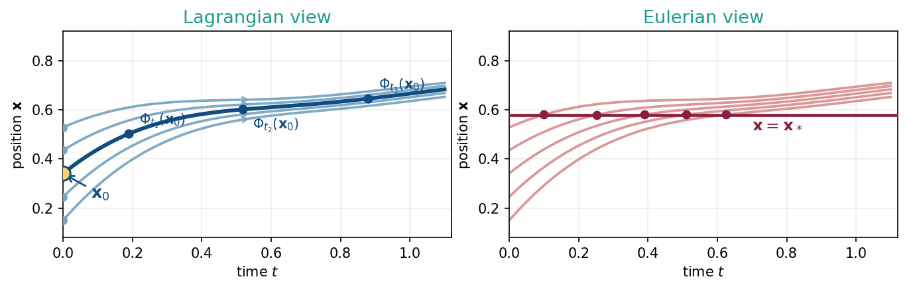
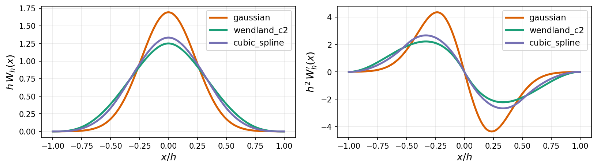
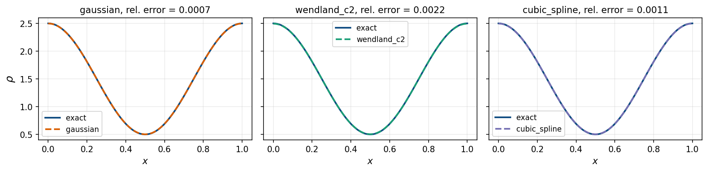
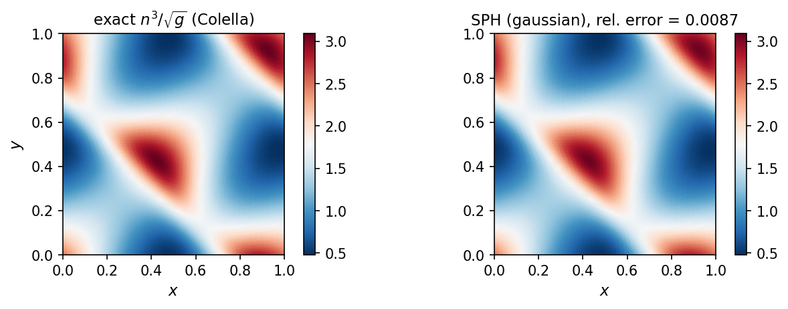
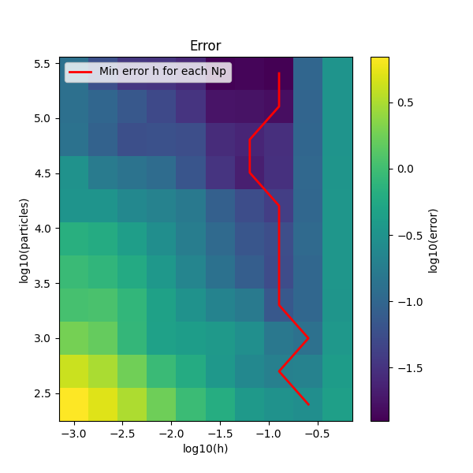

.. _sph_method:

Smoothed particle hydrodynamics (SPH)
-------------------------------------

This page introduces smoothed particle hydrodynamics (SPH) as it is used in Struphy. SPH is a meshless method
for fluids: the fluid is represented by particles (markers) that move with the flow, and the fluid equations are
derived from a variational principle for the particles. The first sections explain the idea and the algorithm;
the derivations follow in :ref:`sph_lagrange_euler` and the sections after it. SPH shares the marker
representation of densities with the :ref:`particle_discrete`, which is assumed known here.
Parts of the material and the figures are adapted from the lecture
`Meshless Structure-Preserving Algorithms <https://github.com/spossann/2026_SPEGEO_Strasbourg_school>`_
(SPEGEO school, Strasbourg 2026).
SPH was introduced by :footcite:t:`Gingold1977` and :footcite:t:`Lucy1977`. Reviews of the method are
:footcite:t:`Monaghan2005`, :footcite:t:`Price2012` (with the derivation from a Lagrangian used here),
:footcite:t:`Springel2010` (astrophysics), :footcite:t:`Wang2016` (multiphase flows) and
:footcite:t:`Lind2020` (convergence and accuracy); a textbook is :footcite:t:`Violeau2012`. A list of all
references is at the :ref:`end of the page <sph_references>`.

.. _sph_overview:

Overview
^^^^^^^^

We consider a compressible fluid with mass density :math:`\rho(t, \mathbf x)` and velocity
:math:`\mathbf u(t, \mathbf x)`, :math:`\mathbf x \in \Omega \subset \mathbb R^3`, governed by the Euler equations

.. math::
    :label: sph:euler

    \partial_t \rho + \nabla \cdot (\rho\, \mathbf u) &= 0\,,
    \\[2mm]
    \rho\, \big(\partial_t \mathbf u + (\mathbf u \cdot \nabla) \mathbf u\big) &= - \nabla p(\rho) - \frac{\rho}{m} \nabla V + \nabla \cdot \boldsymbol\sigma\,,

with a pressure :math:`p(\rho)`, an external potential :math:`V` (e.g. gravity) and, for viscous fluids, a viscous
stress :math:`\boldsymbol \sigma`.

**The idea.** The density is represented by :math:`N` markers that move with the fluid. Marker :math:`p` has a
position :math:`\mathbf x_p(t)`, a velocity :math:`\mathbf v_p(t) = \dot{\mathbf x}_p(t) = \mathbf u(t, \mathbf x_p(t))`
and a constant **weight** :math:`w_p`, the mass it carries:

.. math::
    :label: sph:ansatz

    \rho(t, \mathbf x) \approx \rho_N(t, \mathbf x) := \sum_{p=1}^N w_p\, \delta\big(\mathbf x - \mathbf x_p(t)\big)\,.

Mass conservation, the first equation of :math:numref:`sph:euler`, then holds exactly: the markers are transported
by the flow and keep their weights (see :ref:`pic_eom`). What remains is the momentum equation, which becomes an
equation of motion for each marker. The pressure force needs the density *at the markers*, which the delta
distributions :math:numref:`sph:ansatz` do not provide. SPH replaces it by the **smoothed density**

.. math::
    :label: sph:density

    \rho_p := \rho_h(t, \mathbf x_p) = \sum_{j=1}^N w_j\, W_h(\mathbf x_p - \mathbf x_j)\,,

a :ref:`kernel density estimate <pic_kde>` with a smoothing kernel :math:`W_h` of width :math:`h`. Inserting
:math:numref:`sph:ansatz` and :math:numref:`sph:density` into the action principle of the fluid yields the SPH
equations of motion (:ref:`sph_pressure`):

.. math::
    :label: sph:eom

    \dot{\mathbf x}_p &= \mathbf v_p\,,
    \\[2mm]
    \dot{\mathbf v}_p &= - \frac{1}{m} \nabla V(\mathbf x_p)
    - \sum_{j=1}^N w_j \left( \frac{p(\rho_p)}{\rho_p^2} + \frac{p(\rho_j)}{\rho_j^2} \right) \nabla W_h(\mathbf x_p - \mathbf x_j)
    + \big(\tfrac 1\rho \nabla \cdot \boldsymbol\sigma\big)_h(\mathbf x_p)\,.

The pressure force is a sum over pairs of markers. Because :math:`W_h` vanishes outside a box of half-width
:math:`h`, only neighbouring markers interact, and the cost is :math:`O(N)` with a box-based neighbour search
(:ref:`sph_neighbours`).

SPH is popular because

a. it needs no mesh: free surfaces, large deformations and mixing are handled naturally (see the dam break
   below);
b. mass is conserved exactly, and the pressure force derived from a Lagrangian conserves momentum and energy
   (:ref:`sph_conservation`);
c. it is Lagrangian: there is no numerical diffusion from advection.

Its weaknesses are the smoothing error (bias) of order :math:`h^2`, the sampling noise for too few markers per
kernel, the treatment of boundaries by ghost particles (:ref:`sph_bcs`), and instabilities of regular marker
arrangements (e.g. the "zig-zag" pattern of tessellated markers in shear flow, related to the tensile
instability :footcite:p:`Swegle1995`).

.. _sph_algo:

SPH algorithm in Struphy
^^^^^^^^^^^^^^^^^^^^^^^^

A Struphy SPH simulation consists of the following steps:

1. **Loading.** Place the markers in the unit cube of logical coordinates :math:`\boldsymbol \eta \in (0, 1)^3`,
   either on a regular grid in each sorting box (``loading="tesselation"``, with ``ppb`` markers per box) or at random
   (``"pseudo_random"``, ``"sobol_*"``), see :ref:`pic_loading`. Options:
   :class:`~struphy.particles.parameters.LoadingParameters`, class: :class:`~struphy.pic.particles.ParticlesSPH`.

2. **Weights and velocities.** The weights are the masses of the markers,
   :math:`w_p = \int_{\Omega_0^p} \rho_\textnormal{in}\, \textrm d \mathbf x` for tessellation (integrals over the
   tiles) or :math:`w_p = \rho_\textnormal{in}/(N s)` for random loading, see :ref:`pic_two_ways`; then
   :math:`\sum_p w_p` is the total mass (exactly up to quadrature for tessellation, approximately for random loading). The velocities are set to the initial fluid velocity,
   :math:`\mathbf v_p(0) = \mathbf u_\textnormal{in}(\mathbf x_p(0))`. The initial condition is a fluid background
   (e.g. :class:`~struphy.fields_background.equils.ConstantVelocity`) with perturbations of the density or velocity.

3. **Time stepping.** The propagators of the model (:ref:`sph_models`) are applied by operator splitting. In each
   time step they

   a. move the markers, :math:`\dot{\boldsymbol\eta}_p = DF^{-1} \mathbf v_p`
      (:class:`~struphy.propagators.push_eta.PushEta`);
   b. sort the markers into boxes and fill the ghost boxes at boundaries and MPI interfaces
      (:ref:`sph_neighbours`, :ref:`sph_bcs`);
   c. compute the smoothed densities :math:`\rho_p` and other coefficients at the markers;
   d. update the velocities by the pressure force, the viscous force and external forces.

4. **Diagnostics.** The kinetic energy is saved as a scalar; densities on grids are obtained by
   :ref:`kernel density estimation <pic_kde>` (``KernelDensityPlot``) or :ref:`binning`.

Seven tutorials show SPH simulations in Struphy, from a pressureless fluid in a force field to the dam break:

* `Pressureless fluid in a Beltrami force field <https://struphy-hub.github.io/struphy/_collections/tutorials/tutorial_beltrami_sph.html>`_
* `Shock in a pressureless fluid <https://struphy-hub.github.io/struphy/_collections/tutorials/tutorial_pressureless_sph_shock.html>`_
* `Gas expansion <https://struphy-hub.github.io/struphy/_collections/tutorials/tutorial_gas_expansion_sph.html>`_
* `Standing sound wave, with and without viscosity <https://struphy-hub.github.io/struphy/_collections/tutorials/tutorial_viscous_euler_sph.html>`_
* `Velocity diffusion <https://struphy-hub.github.io/struphy/_collections/tutorials/tutorial_velocity_diffusion_sph.html>`_
* `Hagen-Poiseuille flow <https://struphy-hub.github.io/struphy/_collections/tutorials/tutorial_hagen_poiseuille_sph.html>`_
* `Dam break <https://struphy-hub.github.io/struphy/_collections/tutorials/tutorial_dam_break_sph.html>`_

The evaluation of SPH densities is shown in the developer tutorial
`SPH evaluation kernels <https://struphy-hub.github.io/struphy/_collections/tutorials/dev_tutorial_sph_eval_kernels.html>`_.

**Notation used on this page:**

.. list-table::
    :header-rows: 1
    :widths: 25 75

    * - Symbol
      - Meaning
    * - :math:`\mathbf x`, :math:`\boldsymbol\eta`
      - physical and logical coordinates, :math:`\mathbf x = F(\boldsymbol\eta)`, :math:`\sqrt g = |\det DF|`
    * - :math:`\rho`, :math:`\mathbf u`
      - mass density (a volume form) and fluid velocity
    * - :math:`p`, :math:`i`, :math:`j`, :math:`q`, :math:`N`
      - marker indices, number of markers (:math:`p` is also the pressure :math:`p(\rho)`; the meaning is clear from
        the context)
    * - :math:`\mathbf x_p`, :math:`\mathbf v_p`, :math:`w_p`
      - marker position, velocity and weight (mass)
    * - :math:`W_h`, :math:`h`
      - smoothing kernel and its width (support radius)
    * - :math:`\rho_p`
      - smoothed density at marker :math:`p`, equation :math:numref:`sph:density`
    * - :math:`\mathcal U(\rho)`
      - internal energy per unit mass, with pressure :math:`p = \rho^2\, \partial_\rho \mathcal U`
    * - :math:`\Phi_t`
      - flow map of the fluid, :math:`\Phi_t(\mathbf x_{p0}) = \mathbf x_p(t)`

.. _sph_lagrange_euler:

Lagrangian and Eulerian descriptions
^^^^^^^^^^^^^^^^^^^^^^^^^^^^^^^^^^^^

Fluid motion can be described in two ways (:ref:`figure <fig:sph_lagrange_euler>`):

* **Lagrangian** (follow the fluid parcels): each parcel is labelled by its initial position :math:`\mathbf x_0`,
  and the unknown is the flow map :math:`\Phi_t`, where :math:`\Phi_t(\mathbf x_0)` is the position at time
  :math:`t` of the parcel that started at :math:`\mathbf x_0`. For each :math:`\mathbf x_0` one solves an ODE,

  .. math::

      \frac{\textrm d}{\textrm d t} \Phi_t(\mathbf x_0) = \mathbf u\big(t, \Phi_t(\mathbf x_0)\big)\,, \qquad
      \frac{\textrm d^2}{\textrm d t^2} \Phi_t(\mathbf x_0) = \frac 1m \mathbf F\big(t, \Phi_t(\mathbf x_0)\big)\,,
      \qquad \Phi_0(\mathbf x_0) = \mathbf x_0\,,

  where :math:`\mathbf F` is the force on a parcel.

* **Eulerian** (observe at fixed points): the unknowns are the fields :math:`\rho(t, \mathbf x)` and
  :math:`\mathbf u(t, \mathbf x)`, solutions of the PDEs :math:numref:`sph:euler`.

The two are linked by :math:`\mathbf u(t, \mathbf x) = \dot\Phi_t \circ \Phi_t^{-1}(\mathbf x)`: the acceleration of a
parcel is the material derivative,
:math:`\frac{\textrm d}{\textrm d t} \mathbf u(t, \Phi_t(\mathbf x_0)) = (\partial_t + \mathbf u \cdot \nabla) \mathbf u`.
Particle methods discretize the Lagrangian description: the markers *are* the parcels.

.. _fig:sph_lagrange_euler:

    Lagrangian view: follow the parcel that starts at :math:`\mathbf x_0` along its trajectory
    :math:`\Phi_t(\mathbf x_0)`. Eulerian view: observe the parcels that pass a fixed point :math:`\mathbf x_*`.

**Conservation of mass.** The mass density :math:`\rho` is a volume form transported by the flow: the mass in
every moving region is constant,
:math:`\int_{\Phi_t(\Omega_0)} \rho(t, \mathbf x)\, \textrm d \mathbf x = \int_{\Omega_0} \rho(0, \mathbf x_0)\, \textrm d \mathbf x_0`
for all :math:`\Omega_0` (see :ref:`pic_phase_space` and the :ref:`flow-map figure <fig:pic_flow_map>`). This is
equivalent to each of

.. math::
    :label: sph:mass

    \partial_t \rho + \nabla \cdot (\rho\, \mathbf u) = 0
    \qquad\Longleftrightarrow\qquad
    \rho\big(t, \Phi_t(\mathbf x_0)\big)\, \big|\det D\Phi_t(\mathbf x_0)\big| = \rho(0, \mathbf x_0)\,.

.. _sph_variational:

Variational principle for fluids
^^^^^^^^^^^^^^^^^^^^^^^^^^^^^^^^

The equations of motion of SPH are derived from the action principle of the fluid. We recall it first in the
continuous setting.

**Action of a single particle.** A particle of mass :math:`m` in a potential :math:`V` follows the trajectory that
makes the action stationary,

.. math::

    \mathcal A[\mathbf x] = \int_{t_0}^{t_1} \left( \frac m2 |\dot{\mathbf x}|^2 - V(\mathbf x) \right) \textrm d t\,,
    \qquad \delta \mathcal A = 0
    \qquad\Longleftrightarrow\qquad
    m \ddot{\mathbf x} = - \nabla V(\mathbf x)\,.

**Lagrangian action of a fluid** (see :footcite:t:`Salmon1988` and :footcite:t:`Morrison1998` for the
variational and Hamiltonian formulations of fluid mechanics). For a fluid with initial mass density :math:`\rho(0, \mathbf x_0)` and internal
energy per unit mass :math:`\mathcal U(\rho)`, the action is the sum of the parcel actions, weighted by their
masses:

.. math::

    \mathcal A_\textnormal{Lagrange}(\Phi_t) = \int_0^T \int_{\Omega_0} \left( \frac{|\dot\Phi_t(\mathbf x_0)|^2}{2}
    - \frac 1m V\big(\Phi_t(\mathbf x_0)\big) - \mathcal U\big(\rho(t, \Phi_t(\mathbf x_0))\big) \right)
    \rho(0, \mathbf x_0)\,\textrm d \mathbf x_0\, \textrm d t\,.

**Eulerian action.** The change of variables :math:`\mathbf x = \Phi_t(\mathbf x_0)`, with
:math:`\dot \Phi_t(\mathbf x_0) = \mathbf u(t, \Phi_t(\mathbf x_0))` and the transport of the density
:math:numref:`sph:mass`, replaces the unknown flow map by the two fields :math:`\mathbf u` and :math:`\rho`:

.. math::
    :label: sph:action

    \mathcal A_\textnormal{Euler}(\mathbf u, \rho) = \int_0^T \int_\Omega \left( \frac{|\mathbf u|^2}{2} - \frac 1m V - \mathcal U(\rho) \right)
    \rho\, \textrm d \mathbf x\, \textrm d t\,.

The variations of :math:`\mathbf u` and :math:`\rho` are not free: they are induced by variations of the flow map,
:math:`\boldsymbol\xi := \delta \Phi_t \circ \Phi_t^{-1}`, which gives (Euler-Poincaré reduction,
:footcite:t:`Holm1998`)

.. math::

    \delta \mathbf u = \partial_t \boldsymbol\xi + \mathbf u \cdot \nabla \boldsymbol\xi - \boldsymbol\xi \cdot \nabla \mathbf u\,,
    \qquad
    \delta \rho = - \nabla \cdot (\rho\, \boldsymbol\xi)\,.

Inserting these constrained variations into :math:`\delta \mathcal A_\textnormal{Euler} = 0`, integrating by parts and
requiring the result to vanish for all :math:`\boldsymbol \xi` gives the momentum equation

.. math::

    \partial_t (\rho\, \mathbf u) + \nabla \cdot (\rho\, \mathbf u \mathbf u^\top) = - \nabla p - \frac{\rho}{m} \nabla V\,,
    \qquad p(\rho) = \rho^2\, \frac{\partial \mathcal U}{\partial \rho}(\rho)\,,

which together with mass conservation :math:numref:`sph:mass` is equivalent to :math:numref:`sph:euler` without
viscosity. The pressure enters through the internal energy: the variation of
:math:`-\int \rho\, \mathcal U(\rho)\, \textrm d \mathbf x` is
:math:`-\int (\mathcal U + \rho\, \mathcal U')\, \delta\rho\, \textrm d \mathbf x = -\int \rho\, \nabla(\mathcal U + \rho\, \mathcal U') \cdot \boldsymbol\xi\, \textrm d \mathbf x = -\int \nabla p \cdot \boldsymbol\xi\, \textrm d \mathbf x`,
since :math:`\rho\, \nabla(\mathcal U + \rho\, \mathcal U') = (2 \rho\, \mathcal U' + \rho^2\, \mathcal U'')\, \nabla \rho = \nabla(\rho^2\, \mathcal U')`.

.. _sph_smoothing:

Smoothing kernels
^^^^^^^^^^^^^^^^^

A smoothing kernel :math:`W_h` is a non-negative, even function with :math:`\int W_h\, \textrm d \mathbf x = 1` that
vanishes outside a neighbourhood of size :math:`h` of the origin (a box of half-widths :math:`h_i` for the tensor-product kernels of Struphy) and tends to the delta distribution as :math:`h \to 0`. Then

.. math::

    A(\mathbf x) = \int A(\mathbf y)\, \delta(\mathbf x - \mathbf y)\, \textrm d \mathbf y
    \approx \int A(\mathbf y)\, W_h(\mathbf x - \mathbf y)\, \textrm d \mathbf y
    \approx \sum_{j=1}^N \frac{w_j}{\rho_j} A(\mathbf x_j)\, W_h(\mathbf x - \mathbf x_j)\,,

where the last step is the marker approximation of the integral with the volume :math:`w_j/\rho_j` of marker
:math:`j`. For :math:`A = \rho` this gives the smoothed density :math:numref:`sph:density`; for :math:`A = \mathbf u`
the smoothed velocity

.. math::
    :label: sph:velocity

    \mathbf u_h(\mathbf x) = \sum_{j=1}^N \frac{w_j}{\rho_j}\, \mathbf v_j\, W_h(\mathbf x - \mathbf x_j)\,,

and derivatives are obtained by differentiating the kernel,
:math:`\nabla \mathbf u_h(\mathbf x) = \sum_j \frac{w_j}{\rho_j} \nabla W_h(\mathbf x - \mathbf x_j) \otimes \mathbf v_j`.

Struphy provides three kernel shapes in :mod:`struphy.pic.sph_smoothing_kernels`
(:ref:`figure <fig:sph_kernels>`). In one dimension, with support :math:`|x| \leq h`,

.. math::

    W^\textnormal{trig}_h(x) = \frac{\pi}{4h} \cos\left(\frac{\pi x}{2h}\right)\,, \qquad
    W^\textnormal{gauss}_h(x) = \frac{3}{\sqrt\pi\, h} \exp\left(-\frac{9 x^2}{h^2}\right)\,, \qquad
    W^\textnormal{lin}_h(x) = \frac 1h \left(1 - \frac{|x|}{h}\right)\,.

The Gaussian has standard deviation :math:`h/(3\sqrt 2)` and is cut off at :math:`|x| = h`. Kernels in 2D and 3D
(``"*_2d"``, ``"*_3d"``) are tensor products of these, with a width :math:`h_i` per direction; ``"linear_isotropic_3d"``
is the radial kernel :math:`\frac{3}{\pi h^3}(1 - |\mathbf x|/h)`. The kernels and their gradients are evaluated in
logical coordinates :math:`\boldsymbol \eta`; gradients are mapped to physical space with :math:`DF^{-\top}`.

.. _fig:sph_kernels:

    The 1D smoothing kernels of Struphy (``trigonometric_1d``, ``gaussian_1d``, ``linear_1d``), scaled with the
    width :math:`h`.

:ref:`Figures <fig:sph_density_1d>` below show the smoothed density :math:numref:`sph:density` of tessellated markers
(4 per box, :math:`h` = box size) for :math:`\rho(\eta_1) = 1.5 + \cos(2\pi\eta_1)` and, in 2D, with 16 markers in each of
:math:`12 \times 12` boxes; all kernels recover the density well.

.. _fig:sph_density_1d:

    Smoothed density in 1D with the three kernels (tessellation, 4 markers per box, :math:`h = 1/24`), computed
    with :meth:`~struphy.pic.base.Particles.eval_density`.

    Smoothed density in 2D, :math:`\rho = 1.5 + \cos(2\pi\eta_1)\cos(2\pi\eta_2)`, with the ``gaussian_2d`` kernel
    (tessellation, 16 markers in each of :math:`12 \times 12` boxes, :math:`h = 1/12`).

**Convergence.** Two errors compete (:ref:`figure <fig:sph_convergence>`): the *smoothing bias* grows with
:math:`h` (the kernel is too wide and smooths out features), and the *sampling noise* grows when too few markers lie
in the support of the kernel (small :math:`h` at fixed :math:`N`). For each :math:`N` there is an optimal
:math:`h`, which decreases as :math:`N` grows. Convergence :math:`\rho_h \to \rho` requires :math:`h \to 0` and
:math:`N \to \infty` with :math:`N h^d \to \infty`, i.e. more and more markers per kernel support. The
truncation error of SPH sums is analysed in :footcite:t:`Quinlan2006`; corrected (renormalized) kernel gradients
that improve the order of convergence are discussed in :footcite:t:`Oger2007` and :footcite:t:`Lind2020`.

.. _fig:sph_convergence:

    Error of the smoothed density as a function of the kernel width :math:`h` and of the number of markers
    (randomly drawn, logarithmic scales). The red line marks the optimal :math:`h` for each number of markers.

.. _sph_pressure:

Discrete Lagrangian and pressure force
^^^^^^^^^^^^^^^^^^^^^^^^^^^^^^^^^^^^^^

Inserting the marker ansatz :math:numref:`sph:ansatz` into the action :math:numref:`sph:action`, with
:math:`\mathbf u(t, \mathbf x_p(t)) = \mathbf v_p = \dot{\mathbf x}_p`, reduces the action to a finite-dimensional
one for the marker trajectories:

.. math::

    \mathcal A_N = \int_0^T \sum_{p=1}^N w_p \left( \frac{|\dot{\mathbf x}_p|^2}{2} - \frac 1m V(\mathbf x_p) - \mathcal U(\rho_p) \right) \textrm d t
    =: \int_0^T L_N(\mathbf x_1, \ldots, \mathbf x_N, \dot{\mathbf x}_1, \ldots, \dot{\mathbf x}_N)\, \textrm d t\,.

The internal energy :math:`\mathcal U(\rho(t, \mathbf x_p))` cannot be evaluated with the delta distributions; it is
evaluated with the smoothed density :math:`\rho_p` of :math:numref:`sph:density`, which depends on the positions of
all markers. Without internal energy (pressureless fluid) the markers decouple: the fluid in a given potential
reduces to :math:`N` copies of Newton's equation
:math:`\ddot{\mathbf x}_p = -\nabla V(\mathbf x_p)/m`, while a grid-based discretization of the same problem would
have to solve the nonlinear PDEs :math:numref:`sph:euler`.

**Euler-Lagrange equations.** :math:`\frac{\textrm d}{\textrm d t} \partial L_N/\partial \dot{\mathbf x}_p = \partial L_N/\partial \mathbf x_p`
gives :math:`w_p \ddot{\mathbf x}_p = - w_p \nabla V(\mathbf x_p)/m - \partial_{\mathbf x_p} \sum_q w_q\, \mathcal U(\rho_q)`.
With :math:`\nabla W_h(\mathbf 0) = 0` and the antisymmetry :math:`\nabla W_h(-\mathbf x) = - \nabla W_h(\mathbf x)`,

.. math::

    \frac{\partial \rho_q}{\partial \mathbf x_p} = \delta_{qp} \sum_{j=1}^N w_j\, \nabla W_h(\mathbf x_p - \mathbf x_j) + w_p\, \nabla W_h(\mathbf x_p - \mathbf x_q)\,,

hence :math:`\partial_{\mathbf x_p} \sum_q w_q \mathcal U(\rho_q) = w_p \sum_j w_j \big(\mathcal U'(\rho_p) + \mathcal U'(\rho_j)\big) \nabla W_h(\mathbf x_p - \mathbf x_j)`
with :math:`\mathcal U' = \partial_\rho \mathcal U`. Dividing by :math:`w_p`:

.. math::
    :label: sph:pressure_force

    \dot{\mathbf v}_p = - \frac{1}{m} \nabla V(\mathbf x_p)
    - \sum_{j=1}^N w_j \Big( \mathcal U'(\rho_p) + \mathcal U'(\rho_j) \Big) \nabla W_h(\mathbf x_p - \mathbf x_j)\,,
    \qquad \mathcal U'(\rho) = \frac{p(\rho)}{\rho^2}\,.

This is the standard symmetric SPH pressure force, here derived from a variational principle, as in
:footcite:t:`Bonet2004`, :footcite:t:`Price2004`, :footcite:t:`Springel2002` and :footcite:t:`Price2012`.

**Internal energies in Struphy** (option ``thermodynamics`` of
:class:`~struphy.propagators.push_v_in_sph_pressure.PushVinSPHpressure`):

.. list-table::
    :header-rows: 1
    :widths: 20 30 20 30

    * - Closure
      - :math:`\mathcal U(\rho)`
      - :math:`p(\rho)`
      - :math:`\mathcal U'(\rho)`
    * - ``"isothermal"``
      - :math:`\kappa \ln \rho`
      - :math:`\kappa\, \rho`
      - :math:`\kappa / \rho`
    * - ``"polytropic"``
      - :math:`\kappa\, \rho^{\gamma - 1}/(\gamma - 1)`
      - :math:`\kappa\, \rho^\gamma`
      - :math:`\kappa\, \rho^{\gamma - 2}`

The constant :math:`\kappa` is the option ``kappa`` (:math:`\kappa = 0` gives a pressureless fluid); the adiabatic
index is fixed to :math:`\gamma = 5/3` in the kernels. A constant acceleration :math:`\mathbf g` (option ``gravity``)
plays the role of :math:`-\nabla V/m`.

**In logical coordinates.** Struphy evaluates the kernels in :math:`\boldsymbol\eta`, with
:math:`\nabla_{\mathbf x} W_h = DF^{-\top} \nabla_{\boldsymbol\eta} W_h`. With the masses :math:`w_j` as weights, the sum
:math:numref:`sph:density` with a kernel normalized in :math:`\boldsymbol\eta` approximates the density as a 3-form
in logical space, :math:`\rho \sqrt g` (see :meth:`~struphy.pic.base.Particles.eval_density`), and this is the
:math:`\rho_p` used in the pressure force. For mappings with constant :math:`\sqrt g` (e.g.
:class:`~struphy.geometry.domains.Cuboid`), the factors :math:`\sqrt g` cancel for the isothermal closure, and the
polytropic :math:`\kappa` is rescaled by :math:`(\sqrt g)^{\gamma - 1}`.

.. _sph_conservation:

Conservation properties
^^^^^^^^^^^^^^^^^^^^^^^

The semi-discrete equations :math:numref:`sph:pressure_force` inherit the structure of the Lagrangian
:math:`L_N`:

* **Mass** is conserved exactly, since the weights are constant (in Struphy also after the time discretization).
* **Linear momentum** :math:`\sum_p w_p \mathbf v_p` is conserved without external force: the pressure force between
  markers :math:`p` and :math:`j` is :math:`- w_p w_j (\mathcal U'_p + \mathcal U'_j) \nabla W_h(\mathbf x_p - \mathbf x_j)`,
  and the force of :math:`p` on :math:`j` is its negative (antisymmetry of :math:`\nabla W_h`).
* **Energy** :math:`H_N = \sum_p w_p \big( \frac 12 |\mathbf v_p|^2 + \mathcal U(\rho_p) + V(\mathbf x_p)/m \big)` is
  conserved, because :math:`L_N` does not depend explicitly on time.
* **Angular momentum** is conserved for radial kernels, for which :math:`\nabla W_h(\mathbf x_p - \mathbf x_j)` is
  parallel to :math:`\mathbf x_p - \mathbf x_j`. Most kernels of Struphy are tensor products and not radial;
  ``"linear_isotropic_3d"`` is radial in :math:`\boldsymbol\eta`, hence in :math:`\mathbf x` only for mappings whose
  Jacobian is a multiple of an orthogonal matrix.

**Time discretization.** The pressure step keeps the positions fixed, so its right-hand side is constant during the
step and the forward Euler update is exact; the same holds for the position step
(:class:`~struphy.propagators.push_eta.PushEta`) in Cartesian coordinates. Splitting these two steps gives the
symplectic Euler method (Lie-Trotter splitting) or the Störmer-Verlet method (Strang splitting): the scheme is
symplectic, conserves linear momentum exactly, and has a bounded energy error. The time step is limited by the
stability of the explicit scheme (a CFL condition with the sound speed :math:`\sqrt{p'(\rho)}` and the kernel width),
e.g. :math:`\Delta t = 10^{-3}` in the default parameters of :class:`~struphy.models.EulerSPH`.

.. _sph_viscosity:

Viscosity
^^^^^^^^^

The viscous stress of a Newtonian fluid with dynamic viscosity :math:`\mu \geq 0` is the traceless symmetric part of
the velocity gradient,

.. math::

    \boldsymbol\sigma = \mu \left( \nabla \mathbf u + (\nabla \mathbf u)^\top - \frac 23 (\nabla \cdot \mathbf u)\, \mathbb I \right)\,,
    \qquad \boldsymbol\sigma = \boldsymbol\sigma^\top\,, \quad \textnormal{tr}\, \boldsymbol\sigma = 0\,.

The model docstrings of :class:`~struphy.models.ViscousEulerSPH` and :class:`~struphy.models.IncompressibleNavierStokesSPH` use the opposite sign convention (stress tensor :math:`-\boldsymbol\sigma`). Viscosity is dissipative and not part of the Lagrangian; it is added to the equations of motion (for SPH
formulations of viscous flows, see e.g. :footcite:t:`Morris1997`). In SPH, the stress is
evaluated at the markers from the gradient of the smoothed velocity :math:numref:`sph:velocity`,
:math:`\boldsymbol \sigma_i := \boldsymbol\sigma(\nabla \mathbf u_h(\mathbf x_i))`, and the force is the SPH estimate of
its divergence:

.. math::
    :label: sph:viscous_force

    \dot{\mathbf v}_p = (\nabla \cdot \boldsymbol\sigma)_h(\mathbf x_p) = \sum_{i=1}^N \frac{w_i}{\rho_i}\, \boldsymbol\sigma_i\, \nabla W_h(\mathbf x_p - \mathbf x_i)\,.

This is implemented in :class:`~struphy.propagators.push_v_in_viscous_potential.PushVinViscousPotential` (in logical
coordinates in Piola form, with forward Euler time stepping). Two remarks:

* the factor :math:`1/\rho_p` of the momentum equation :math:numref:`sph:euler` is not applied, so the viscous term is
  exact for :math:`\rho = 1` (as in the verification tests below);
* the force :math:numref:`sph:viscous_force` is not pairwise antisymmetric, so momentum is conserved only
  approximately by the viscous step.

.. _sph_bcs:

Boundary conditions
^^^^^^^^^^^^^^^^^^^

Near a boundary the support of the kernel extends outside the domain, where there are no markers. Struphy fills this
region with **ghost particles**: copies of the markers near the boundary, mirrored at the boundary
(:math:`\eta_i \mapsto -\eta_i` at :math:`\eta_i = 0`, :math:`\eta_i \mapsto 2 - \eta_i` at :math:`\eta_i = 1`).
The ghost particles enter the sums :math:numref:`sph:density`, :math:numref:`sph:pressure_force` and
:math:numref:`sph:viscous_force` but are not pushed. The boundary condition for the SPH sums is set per direction
with ``bc_sph`` in :class:`~struphy.particles.parameters.BoundaryParameters`:

.. list-table::
    :header-rows: 1
    :widths: 18 42 40

    * - ``bc_sph``
      - Ghost particles
      - Effect
    * - ``"periodic"``
      - copies from the opposite side of the domain
      - periodic density and velocity
    * - ``"mirror"``
      - mirrored positions, same weights and velocities
      - even density at the wall (zero normal derivative); velocities are not mirrored. Used for walls of pressure-driven flows (dam break), with the markers reflected by ``bc="reflect"``
    * - ``"fixed"``
      - mirrored positions, negative weights :math:`-f_\textnormal{in}/(N s^0)`
      - odd density, :math:`\rho \to 0` at the wall
    * - ``"noslip"``
      - mirrored positions, negated velocities
      - :math:`\mathbf u = 0` at the wall (viscous flows)

The markers themselves are kept in the domain with the marker boundary condition ``bc`` (``"periodic"``,
``"reflect"``, ``"remove"``, ``"refill"``), e.g. ``bc=("reflect", "reflect", "periodic")`` together with
``bc_sph=("mirror", "mirror", "periodic")`` for the dam break, and ``bc_sph=("periodic", "noslip", "periodic")`` for
a channel flow.

.. _sph_neighbours:

Neighbour search and parallelization
^^^^^^^^^^^^^^^^^^^^^^^^^^^^^^^^^^^^

The sums over :math:`j` in :math:numref:`sph:density` and :math:numref:`sph:pressure_force` only include markers within
distance :math:`h` of :math:`\mathbf x_p`. Struphy sorts the markers into a regular grid of **sorting boxes** in the
logical unit cube (``boxes_per_dim`` in :class:`~struphy.particles.parameters.SortingParameters`), and the kernel width
in direction :math:`i` is at most one box, :math:`h_i \leq 1/n_i` (default :math:`h_i = 1/n_i`). The neighbours of a
marker are then in its own box and the 26 adjacent boxes (3 x 3 x 3 boxes in 3D), see the
:ref:`figure on kernel density estimation <fig:pic_kernel_boxes>`. Each SPH step

1. puts the markers into their boxes (:meth:`~struphy.pic.base.Particles.put_particles_in_boxes`);
2. fills a layer of ghost boxes around the boxes of each MPI process with copies of the markers of the neighbouring
   processes, or with the ghost particles of the :ref:`boundary conditions <sph_bcs>` at the domain boundary;
3. computes the coefficients (e.g. :math:`\rho_p`, :math:`w_p/\rho_p`) for all markers, and then the forces with a
   loop over the 27 neighbour boxes of each marker.

The cost is :math:`O(N \cdot n_\textnormal{nb})`, where :math:`n_\textnormal{nb}` is the number of markers in 27 boxes.
With MPI, the boxes are distributed over the processes, so ``boxes_per_dim`` must be divisible by the number of
processes in the decomposed direction.

.. _sph_incompressible:

Incompressible flows
^^^^^^^^^^^^^^^^^^^^

For incompressible flows, :math:`\nabla \cdot \mathbf u = 0`, the pressure is not a function of the density but a
Lagrange multiplier. :class:`~struphy.models.IncompressibleNavierStokesSPH` computes it with **Chorin's projection
method** (for a projection method entirely in SPH, see :footcite:t:`Cummins1999`) on the finite element grid (see :ref:`geomFE`): after the viscous step, the divergence of the marker
velocities is deposited on the grid, the pressure :math:`p \in H^1` is found from the Poisson equation
:math:`\Delta p = \nabla \cdot \mathbf u / \Delta t` (:class:`~struphy.propagators.poisson_solve.PoissonSolve`), and the
markers are pushed by the pressure gradient
(:class:`~struphy.propagators.push_v_in_force_field.PushVinForceField`), which removes the divergent part of the
velocity.

.. _sph_models:

SPH models in Struphy
^^^^^^^^^^^^^^^^^^^^^

The SPH models form one family; each model adds terms (propagators) to its parent:

.. list-table::
    :header-rows: 1
    :widths: 28 38 34

    * - Model
      - Equations
      - Propagators added
    * - :class:`~struphy.models.ColdEulerSPH`
      - pressureless Euler in a force field :math:`\mathbf F` and magnetic field :math:`\mathbf B_0`
      - :class:`~struphy.propagators.push_eta.PushEta`, :class:`~struphy.propagators.push_vxb.PushVxB`,
        :class:`~struphy.propagators.push_v_in_force_field.PushVinForceField`
    * - :class:`~struphy.models.EulerSPH`
      - adds pressure :math:`p(\rho)` and gravity
      - :class:`~struphy.propagators.push_v_in_sph_pressure.PushVinSPHpressure`
    * - :class:`~struphy.models.ViscousEulerSPH`
      - adds the viscous stress
      - :class:`~struphy.propagators.push_v_in_viscous_potential.PushVinViscousPotential`
    * - :class:`~struphy.models.IncompressibleNavierStokesSPH`
      - incompressible Navier-Stokes (child of ``ColdEulerSPH``)
      - viscous push, :class:`~struphy.propagators.poisson_solve.PoissonSolve` and pressure push (Chorin projection)

The models are verified against analytic solutions in ``src/struphy/models/tests/verification/``:

* ``ColdEulerSPH``: oscillation in a harmonic potential (second-order convergence in :math:`\Delta t` with Strang
  splitting, mass conserved to machine precision);
* ``EulerSPH``: isothermal standing sound wave in 1D over one period;
* ``ViscousEulerSPH``: damped sound wave (decay rate :math:`\frac 23 \mu k^2`), velocity diffusion (decay rate
  :math:`\frac 43 \mu k^2`) and Hagen-Poiseuille flow (parabolic profile between no-slip walls, as in
  :footcite:t:`Morris1997`);
* ``IncompressibleNavierStokesSPH``: Chorin projection and decay of a shear flow between no-slip walls.

The dam break test (``ViscousEulerSPH``, a classic SPH free-surface problem :footcite:p:`Monaghan1994`) is a
robustness check only: it verifies that the markers stay in the domain.

The Hagen-Poiseuille flow and the dam break are shown with animations in the tutorials
(see :ref:`sph_algo`).

.. _sph_references:

References
^^^^^^^^^^

.. footbibliography::
